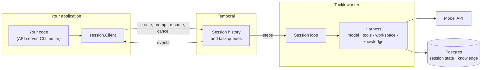

# Tacklr

[](https://github.com/Ryanaldo34/tacklr/actions/workflows/ci.yml)
[](https://github.com/Ryanaldo34/tacklr/blob/main/.testcoverage.yml)
[](https://pkg.go.dev/github.com/ryanaldo34/tacklr)
[](https://github.com/Ryanaldo34/tacklr/blob/main/go.mod)
[](https://github.com/Ryanaldo34/tacklr/blob/main/LICENSE)

Tacklr is a Go SDK for running AI agents as long-lived sessions on your servers. You give it a model and tools. Tacklr runs the agent loop: it calls the model, runs the tools the model asks for, keeps the conversation, and saves the session after every step, so a session can stop, wait for a person, survive a restart, and continue on another machine.

Tacklr runs on Linux only.

## Goals

- **Sessions that last.** A session can run for hours, pause for a person's answer, and pick up after a crash or a deploy. Tacklr runs sessions on [Temporal](https://temporal.io), which records each step so finished work is never done twice.
- **A focused context window.** The agent works from a plan and a to-do list. When the window fills up, older messages are summarized. With a knowledge store, the agent can still search the full history.
- **A safe workspace.** The agent reads and writes files under `/workspace`, which you build from local folders, S3, Azure Blob, Google Drive, Microsoft 365, or git. It never sees host paths or credentials.
- **Knowledge on demand.** An optional knowledge store lets the agent search, read, and save facts instead of keeping everything in its context window.

## How it fits together



Your application talks to sessions through a `session.Client`: it creates a session, sends prompts, answers questions, and reads a stream of events. It does not run the agent itself, and it imports none of the agent code.

A Tacklr worker runs the sessions. For each step, the session loop asks the harness to do one piece of work: one model request, or one tool call. Temporal records the result of each step. If a worker stops, another worker continues the session from the last recorded step.

Session state (the conversation, the plan, the results of tool calls) and the optional knowledge store live in Postgres. For local development, Tacklr also has in-memory stores.

## Getting started

### What you need

- Linux and Go 1.27 or later.
- A Temporal server. For development, install the [Temporal CLI](https://docs.temporal.io/cli) and run `temporal server start-dev`.
- An API key for an OpenAI-compatible model endpoint.

```bash
go get github.com/ryanaldo34/tacklr
```

### 1. Write a tool

A tool is a Go function. Tacklr builds the tool's input schema from the fields of its argument struct.

```go
type weatherArgs struct {
	City string `json:"city" desc:"City name"`
}

func weatherTool(client *http.Client) *tacklr.Tool {
	return tacklr.NewTool(tacklr.ToolConfig{
		Name:        "get_weather",
		Description: "Return the current weather for a city.",
		Handler: func(ctx context.Context, args weatherArgs) (string, error) {
			req, err := http.NewRequestWithContext(ctx, http.MethodGet, "https://wttr.in/"+url.PathEscape(args.City)+"?format=3", nil)
			if err != nil {
				return "", err
			}
			resp, err := client.Do(req)
			if err != nil {
				return "", err
			}
			defer resp.Body.Close()
			body, err := io.ReadAll(resp.Body)
			return string(body), err
		},
	})
}
```

### 2. Run an agent

This program runs a worker and a client in one process, with in-memory stores. It creates a session, sends one prompt, and prints the agent's reply.

```go
package main

import (
	"context"
	"fmt"
	"log"
	"net/http"
	"os"
	"time"

	"go.temporal.io/sdk/client"

	"github.com/ryanaldo34/tacklr"
	"github.com/ryanaldo34/tacklr/openai"
	"github.com/ryanaldo34/tacklr/session"
	"github.com/ryanaldo34/tacklr/session/temporal"
	"github.com/ryanaldo34/tacklr/session/temporal/worker"
)

func main() {
	ctx := context.Background()

	model := openai.New(&http.Client{Timeout: 2 * time.Minute}).
		WithURL(os.Getenv("OPENAI_BASE_URL")).
		WithApiKey(os.Getenv("OPENAI_API_KEY")).
		WithModel(os.Getenv("OPENAI_MODEL"))

	agent := tacklr.AgentOptions{
		Name:         "assistant",
		SystemPrompt: "You are a helpful assistant.",
		Model:        model,
		Tools:        []*tacklr.Tool{weatherTool(http.DefaultClient)},
	}

	// In-memory stores work inside one process. Production uses Postgres.
	store, secrets := session.NewMemoryStore(), session.NewMemorySecretStorage()

	c, err := temporal.Dial(client.Options{HostPort: "localhost:7233"})
	if err != nil {
		log.Fatal(err)
	}
	defer c.Close()

	// The worker runs sessions.
	w := worker.New(c, worker.Config{Agent: agent, Store: store, Secrets: secrets})
	if err := w.Start(); err != nil {
		log.Fatal(err)
	}
	defer w.Stop()

	// The client starts sessions and talks to them.
	sessions := temporal.Open(c, temporal.Config{Store: store, Secrets: secrets})

	id, err := sessions.CreateSession(ctx, session.CreateSession{})
	if err != nil {
		log.Fatal(err)
	}
	head, err := sessions.Head(ctx, id)
	if err != nil {
		log.Fatal(err)
	}
	events, err := sessions.Subscribe(ctx, id, head)
	if err != nil {
		log.Fatal(err)
	}
	defer events.Close()

	if err := sessions.Prompt(ctx, id, session.Prompt{Text: "What is the weather in Lisbon?"}); err != nil {
		log.Fatal(err)
	}
	for ev := range events.Events() {
		switch ev.Type {
		case session.EventMessage:
			fmt.Print(ev.Content)
		case session.EventComplete, session.EventError:
			fmt.Println()
			return
		}
	}
}
```

Run it with the dev server running:

```bash
OPENAI_API_KEY=... OPENAI_MODEL=gpt-5-mini go run .
```

The model calls `get_weather`, Tacklr runs the tool, and the model writes the answer from the result. Each prompt to the same session continues the same conversation.

### 3. Answer the agent's questions

A tool can stop and ask a person something. The session waits, and your client gets an `EventInterrupt` event. Send the answer with `Resume`, keyed by the event's `MessageID`.

```go
func deleteTool() *tacklr.Tool {
	return tacklr.NewTool(tacklr.ToolConfig{
		Name:        "delete_report",
		Description: "Delete a report after the user confirms.",
		Handler: func(ctx context.Context, args struct {
			Name string `json:"name" desc:"Report name"`
		}, cc *tacklr.CallContext) (string, error) {
			answer, err := cc.Park(&tacklr.UserSelectionInterrupt{
				Question: "Delete " + args.Name + "?",
				Options:  []tacklr.UserChoice{{Title: "Delete"}, {Title: "Keep"}},
			})
			if err != nil {
				return "", err // the session waits here for the answer
			}
			if answer.(*tacklr.UserSelectionInterrupt).ConfirmedChoice.Title != "Delete" {
				return "kept " + args.Name, nil
			}
			return "deleted " + args.Name, nil
		},
	})
}

// answer picks the first option of a question the session is waiting on.
func answer(ctx context.Context, sessions session.Client, id session.ID, ev session.Event) error {
	return sessions.Resume(ctx, id, session.Resume{
		Responses: map[string][]byte{ev.MessageID: []byte(`{"selectionIdx":0}`)},
	})
}
```

When the session resumes, the tool runs again and `Park` returns the answer. Tools that already finished do not run again.

The built-in tools that change files or run commands ask for permission the same way. To skip the question for a tool, list it in `AgentOptions.AllowTools`.

## Next steps

### Give the agent a workspace

`OpenVFS` builds the agent's `/workspace`. Each `vfs.At` mounts a source under a name.

```go
func workspace() vfs.OpenVFS {
	return vfs.Tree(
		vfs.At("work", vfs.Local("/srv/tacklr/work")),            // /workspace/work
		vfs.At("docs", vfs.Local("/srv/tacklr/docs")).ReadOnly(), // the agent can read, not write
	)
}
```

With a workspace, the agent gets `read`, `write`, `write_document`, `write_spreadsheet`, and `run_command`. Commands run in a sandbox that sees this session's workspace, not other sessions' files. Other sources: `vfs.S3`, `vfs.Blob`, `vfs.Drive`, `vfs.Graph`, `vfs.Git`. See [docs/vfs.md](docs/vfs.md).

### Add a knowledge store

Set `AgentOptions.Brain` to give the agent `search`, `open`, `related`, and `save`. The agent can only see and save data inside `SearchNamespace`.

```go
func knowledge(ctx context.Context) (*brain.Engine, brain.Namespace, error) {
	note := brain.KindSpec{Kind: "Note", Description: "A fact worth keeping", IsParent: true}
	eng, err := brain.NewEngine(brain.NewMemoryStore(), brain.WithKinds(note))
	if err != nil {
		return nil, nil, err
	}
	ns, err := brain.ParseNamespace("org", "acme")
	return eng, ns, err
}
```

Then set `Brain: eng`, `SearchNamespace: ns`, and `BrainWriteKinds: []string{"Note"}` on the agent. For production, use the Postgres store (`brain/postgres`), and optionally a graph (`brain/helixgraph`). See [docs/knowledge.md](docs/knowledge.md).

### Add specialists

A specialist is a second agent with its own instructions, model, and tools. The main agent decides when to hand it a task with the built-in `spawn_specialist` tool, and gets back only the specialist's answer.

```go
func withReviewer(agent tacklr.AgentOptions) tacklr.AgentOptions {
	agent.Specialists = []*tacklr.Specialist{{
		Name:         "reviewer",
		Description:  "Reviews a change and reports problems.",
		Instructions: "Review the change. Report only real problems.",
		Model:        agent.Model,
	}}
	return agent
}
```

### Run long jobs

For work that is not an agent, such as a data pipeline, register a job on the worker. A tool starts it with `cc.Schedule`. With `Wait: true`, the job's output becomes the tool's result. Without it, the session continues, and the output arrives later as a message.

```go
func jobs() map[string]worker.JobHandler {
	return map[string]worker.JobHandler{
		"export": func(ctx context.Context, task string) (string, error) {
			return "exported " + task, nil
		},
	}
}
```

Pass them as `worker.Config{Jobs: jobs()}`.

### Run in production

Production splits the program from step 2 into two parts, and stores state in Postgres:

- **Workers** run `worker.New(...)`. Run as many as you need. A session's steps go to the worker that already has that session loaded.
- **Your application** runs only `temporal.Open(...)` and calls `session.Client`. It does not import the worker or the harness.
- **Both** use the same Postgres stores from `session/postgres` (imported below as `sessionpg`).

```go
func stores(ctx context.Context, pool *pgxpool.Pool, key []byte) (session.Store, session.SecretStorage, error) {
	db, err := sessionpg.New(pool, sessionpg.Options{})
	if err != nil {
		return nil, nil, err
	}
	if err := db.Setup(ctx); err != nil { // creates the tables if they do not exist
		return nil, nil, err
	}
	sealer, err := sessionpg.NewAESGCM(key) // 32 bytes; or your own Sealer over a KMS
	if err != nil {
		return nil, nil, err
	}
	return db.Store(), db.Secrets(sealer), nil
}
```

`SecretStorage` holds the credentials your users pass with a prompt, such as a user's Google Drive token. It encrypts each session's credentials before it writes them. Your own service credentials do not go there: pass them to the sources you build, such as `vfs.S3(client, bucket)`.

For tracing, add Temporal's OpenTelemetry plugin to your Temporal client; see [docs/session.md](docs/session.md).

## Extending Tacklr

You can replace each of these parts:

| To change | Implement | Built in |
|---|---|---|
| The model | `tacklr.Model` | `openai` (OpenAI-compatible endpoints) |
| A workspace source | `vfs.Provider` | `Local`, `S3`, `Blob`, `Drive`, `Graph`, `Git` |
| Session storage | `session.Store`, `session.SecretStorage`, `session.EventLog` | memory, `session/postgres` |
| Knowledge storage | `brain.Store`, `brain.Graph` | memory, `brain/postgres`, `brain/helixgraph` |
| The protocol your clients speak | `server.Protocol` | ACP (`server/acp`) |
| Where sessions run | `session.Client` and `loop.Executor` | Temporal (`session/temporal`) |

A custom store can check itself against the shared tests in `session/storetest` and `brain/storetest`.

Tacklr also includes web search and fetch tools (`web`), email tools (`email/gmail`, `email/outlook`), MCP servers (`AgentOptions.MCPConfigs`), skill files the agent can read (`AgentOptions.SkillsPath`), and OpenTelemetry setup (`telemetry`).

## Documentation

| Doc | Covers |
|---|---|
| [docs/session.md](docs/session.md) | Sessions, the Temporal client and worker, questions and answers, specialists and jobs, credentials |
| [docs/tools.md](docs/tools.md) | Writing tools, `CallContext`, permissions |
| [docs/vfs.md](docs/vfs.md) | The workspace, its sources, documents and spreadsheets |
| [docs/knowledge.md](docs/knowledge.md) | The knowledge store: search, kinds, graph, file indexing |
| [docs/fuse-vfs-run-command.md](docs/fuse-vfs-run-command.md) | How `run_command` sees the workspace |

## Contributing

Tacklr needs Go 1.27 and Linux. On a Mac, use a Linux VM. Read [AGENTS.md](AGENTS.md) for the coding and testing standards.

```bash
make cover   # all tests with the race detector, plus the coverage check
make vet
make lint
```

The tests start their own containers (Postgres, Helix, Temporal, S3, Azure Blob) with Testcontainers, so they need Docker, FUSE, and user namespaces. Plain `go test ./...` runs everything.

## License

Apache 2.0. See [LICENSE](LICENSE).
