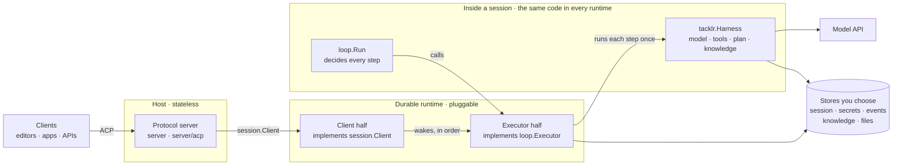
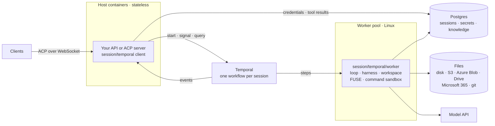

# Tacklr

[](https://github.com/Ryanaldo34/tacklr/actions/workflows/ci.yml)
[](https://github.com/Ryanaldo34/tacklr/blob/main/.testcoverage.yml)
[](https://pkg.go.dev/github.com/ryanaldo34/tacklr)
[](https://github.com/Ryanaldo34/tacklr/blob/main/go.mod)
[](https://github.com/Ryanaldo34/tacklr/blob/main/LICENSE)

Tacklr is a Go SDK for running AI agents as long-lived sessions in the cloud. You supply a model and tools. Tacklr runs the agent loop: it calls the model, runs the tools the model asks for, and records every step, so a session can wait for a person, survive a crash or a deploy, and continue on another machine.

## Design goals

**For the agent**

- **Focused context.** The agent works from a plan and a to-do list. Finishing a to-do rebuilds the context for the next one, and old messages are summarized instead of piling up. A specialist runs as its own session and returns only its answer.
- **A bounded world.** The agent sees one `/workspace` of virtual paths, built from the sources you choose. It never sees host paths, other sessions, or credentials.
- **Knowledge on demand.** An optional knowledge store lets the agent search, read, and save facts when it needs them, instead of carrying them in its context.

**For your infrastructure**

- **Sessions outlive processes.** A durable runtime records the result of every step. When a worker stops, another one continues the session, and finished steps never run twice.
- **Stateless hosts.** Your API servers keep no session state. They call one interface, `session.Client`, and scale like any web service. Workers scale on their own.
- **Each binary links only what it needs.** A host does not link the agent code. A worker links only the storage adapters you import, and the Google and Microsoft adapters use plain HTTP instead of vendor SDKs. The harness core also builds for WebAssembly, so it can run outside a Linux worker.
- **State lives in managed services.** Sessions, encrypted user credentials, and knowledge go to Postgres; files stay in the sources they came from. Checkpoints store how to rebuild the workspace, never tokens or file contents.
- **The runtime is pluggable.** The turn loop is the same everywhere. A runtime implements two interfaces, and [Temporal](https://temporal.io) is the one that ships today.

## Architecture

### The generic shape

Every deployment has the same three parts. Only the durable runtime in the middle changes.



- **`session.Client`** is what a host calls from outside a session: create, prompt, resume, cancel, and subscribe to events.
- **`loop.Executor`** is what the turn loop calls from inside one: run a model request, run the tool calls, commit the state, wait for the next wake.
- **`loop.Run`** makes every decision. The runtime only carries out the steps durably, so a new runtime never changes how an agent behaves.

### On Temporal

Temporal is the supported runtime. Each session is a workflow, and each model request and tool call is a recorded activity.



| Binary | Imports | Needs |
|---|---|---|
| Host | `session/temporal`, `server`, `server/acp`, `session/postgres` | A plain container |
| Worker | `session/temporal/worker`, plus the workspace sources, knowledge store, and tools you use | Linux, and FUSE with user namespaces for `run_command` |

A session's steps go to the worker that already has it loaded. If that worker stops, any other worker rebuilds the session from Postgres and continues.

A Cloudflare Durable Objects runtime is planned. The core already builds for WebAssembly; the runtime that would hold a session in a Durable Object does not exist yet.

## Getting started

You need Linux, Go 1.27 or later, a Temporal server, and an API key for an OpenAI-compatible endpoint. For development, install the [Temporal CLI](https://docs.temporal.io/cli) and run `temporal server start-dev`.

```bash
go get github.com/ryanaldo34/tacklr
```

### 1. Write a tool

A tool is a Go function. Tacklr builds its input schema from the fields of the argument struct.

```go
type weatherArgs struct {
	City string `json:"city" desc:"City name"`
}

func weatherTool(client *http.Client) *tacklr.Tool {
	return tacklr.NewTool(tacklr.ToolConfig{
		Name:        "get_weather",
		Description: "Return the current weather for a city.",
		Handler: func(ctx context.Context, args weatherArgs) (string, error) {
			req, err := http.NewRequestWithContext(ctx, http.MethodGet, "https://wttr.in/"+url.PathEscape(args.City)+"?format=3", nil)
			if err != nil {
				return "", err
			}
			resp, err := client.Do(req)
			if err != nil {
				return "", err
			}
			defer resp.Body.Close()
			body, err := io.ReadAll(resp.Body)
			return string(body), err
		},
	})
}
```

### 2. Run an agent

This program runs a worker and a client in one process with in-memory stores. It creates a session, sends one prompt, and prints the reply.

```go
package main

import (
	"context"
	"fmt"
	"log"
	"net/http"
	"os"
	"time"

	"go.temporal.io/sdk/client"

	"github.com/ryanaldo34/tacklr"
	"github.com/ryanaldo34/tacklr/openai"
	"github.com/ryanaldo34/tacklr/session"
	"github.com/ryanaldo34/tacklr/session/temporal"
	"github.com/ryanaldo34/tacklr/session/temporal/worker"
)

func main() {
	ctx := context.Background()

	model := openai.New(&http.Client{Timeout: 2 * time.Minute}).
		WithURL(os.Getenv("OPENAI_BASE_URL")).
		WithApiKey(os.Getenv("OPENAI_API_KEY")).
		WithModel(os.Getenv("OPENAI_MODEL"))

	agent := tacklr.AgentOptions{
		Name:         "assistant",
		SystemPrompt: "You are a helpful assistant.",
		Model:        model,
		Tools:        []*tacklr.Tool{weatherTool(http.DefaultClient)},
	}

	// In-memory stores work inside one process. Production uses Postgres.
	store, secrets := session.NewMemoryStore(), session.NewMemorySecretStorage()

	c, err := temporal.Dial(client.Options{HostPort: "localhost:7233"})
	if err != nil {
		log.Fatal(err)
	}
	defer c.Close()

	// The worker runs sessions.
	w := worker.New(c, worker.Config{Agent: agent, Store: store, Secrets: secrets})
	if err := w.Start(); err != nil {
		log.Fatal(err)
	}
	defer w.Stop()

	// The client starts sessions and talks to them.
	sessions := temporal.Open(c, temporal.Config{Store: store, Secrets: secrets})

	id, err := sessions.CreateSession(ctx, session.CreateSession{})
	if err != nil {
		log.Fatal(err)
	}
	head, err := sessions.Head(ctx, id)
	if err != nil {
		log.Fatal(err)
	}
	events, err := sessions.Subscribe(ctx, id, head)
	if err != nil {
		log.Fatal(err)
	}
	defer events.Close()

	if err := sessions.Prompt(ctx, id, session.Prompt{Text: "What is the weather in Lisbon?"}); err != nil {
		log.Fatal(err)
	}
	for ev := range events.Events() {
		switch ev.Type {
		case session.EventMessage:
			fmt.Print(ev.Content)
		case session.EventComplete, session.EventError:
			fmt.Println()
			return
		}
	}
}
```

Run it while the dev server is up:

```bash
OPENAI_API_KEY=... OPENAI_MODEL=gpt-5-mini go run .
```

The model calls `get_weather`, Tacklr runs it, and the model answers from the result. Later prompts to the same session continue the same conversation.

### 3. Ask a person

A tool can pause the session to ask a question. Your client gets an `EventInterrupt` event and answers with `Resume`, keyed by the event's `MessageID`.

```go
func deleteTool() *tacklr.Tool {
	return tacklr.NewTool(tacklr.ToolConfig{
		Name:        "delete_report",
		Description: "Delete a report after the user confirms.",
		Handler: func(ctx context.Context, args struct {
			Name string `json:"name" desc:"Report name"`
		}, cc *tacklr.CallContext) (string, error) {
			answer, err := cc.Park(&tacklr.UserSelectionInterrupt{
				Question: "Delete " + args.Name + "?",
				Options:  []tacklr.UserChoice{{Title: "Delete"}, {Title: "Keep"}},
			})
			if err != nil {
				return "", err // the session waits here for the answer
			}
			if answer.(*tacklr.UserSelectionInterrupt).ConfirmedChoice.Title != "Delete" {
				return "kept " + args.Name, nil
			}
			return "deleted " + args.Name, nil
		},
	})
}

// confirm answers a question the session is waiting on with its first option.
func confirm(ctx context.Context, sessions session.Client, id session.ID, ev session.Event) error {
	return sessions.Resume(ctx, id, session.Resume{
		Responses: map[string][]byte{ev.MessageID: []byte(`{"selectionIdx":0}`)},
	})
}
```

When the session resumes, the tool runs again and `Park` returns the answer. Tool calls that already finished are not repeated. Built-in tools that change files or run commands ask for permission the same way; list a tool in `AgentOptions.AllowTools` to skip the question.

## Next steps

### Give the agent a workspace

Set `worker.Config.Workspace` to build each session's `/workspace`. Each `vfs.At` mounts a source under a name.

```go
func agentWorkspace() workspace.Config {
	return workspace.Config{Open: vfs.Tree(
		vfs.At("work", vfs.Local("/srv/tacklr/work")),            // /workspace/work
		vfs.At("docs", vfs.Local("/srv/tacklr/docs")).ReadOnly(), // read, not write
	)}
}
```

The agent gets `read`, `write`, `write_document`, and `write_spreadsheet`. Set `worker.Config.FuseRoot` to also give it `run_command`, which runs in a sandbox that sees only that session's workspace. Other sources are `vfs.S3`, `vfs.Blob`, `vfs.Drive`, `vfs.Graph`, and `vfs.Git`; add `.WithCodecs(adapters.Codecs()...)` to the tree to read and write Word and Excel files. See [docs/vfs.md](docs/vfs.md).

### Add a knowledge store

Set `AgentOptions.Brain` to give the agent `search`, `open`, `related`, and `save`. It can only read and write inside `SearchNamespace`.

```go
func knowledge() (*brain.Engine, brain.Namespace, error) {
	note := brain.KindSpec{Kind: "Note", Description: "A fact worth keeping", IsParent: true}
	eng, err := brain.NewEngine(brain.NewMemoryStore(), brain.WithKinds(note))
	if err != nil {
		return nil, nil, err
	}
	ns, err := brain.ParseNamespace("org", "acme")
	return eng, ns, err
}
```

Set `Brain: eng`, `SearchNamespace: ns`, and `BrainWriteKinds: []string{"Note"}` on the agent. In production, use `brain/postgres`, and optionally a graph with `brain/helixgraph`. See [docs/knowledge.md](docs/knowledge.md).

### Add specialists

A specialist is a second agent with its own instructions, model, and tools. The main agent hands it a task with the built-in `spawn_specialist` tool and gets back only the answer.

```go
func withReviewer(agent tacklr.AgentOptions) tacklr.AgentOptions {
	agent.Specialists = []*tacklr.Specialist{{
		Name:         "reviewer",
		Description:  "Reviews a change and reports problems.",
		Instructions: "Review the change. Report only real problems.",
		Model:        agent.Model,
	}}
	return agent
}
```

For long work that is not an agent, such as a data export, register a `worker.JobHandler` in `worker.Config.Jobs` and start it from a tool with `cc.Schedule`. See [docs/session.md](docs/session.md).

### Run in production

Split the program from step 2 along the lines of the [Temporal diagram](#on-temporal): hosts call only `temporal.Open`, workers call only `worker.New`, and both use the Postgres stores from `session/postgres`.

```go
// sessionpg is github.com/ryanaldo34/tacklr/session/postgres.
func stores(ctx context.Context, pool *pgxpool.Pool, key []byte) (session.Store, session.SecretStorage, error) {
	db, err := sessionpg.New(pool, sessionpg.Options{})
	if err != nil {
		return nil, nil, err
	}
	if err := db.Setup(ctx); err != nil { // creates the tables if they do not exist
		return nil, nil, err
	}
	sealer, err := sessionpg.NewAESGCM(key) // 32 bytes, or your own Sealer over a KMS
	if err != nil {
		return nil, nil, err
	}
	return db.Store(), db.Secrets(sealer), nil
}
```

`SecretStorage` holds the credentials your users send with a prompt, such as their Google Drive token, encrypted per session. Your own service credentials go to the sources you build, such as `vfs.S3(client, bucket)`.

## Extending Tacklr

| To change | Implement | Built in |
|---|---|---|
| The model | `tacklr.Model` | `openai` (OpenAI-compatible endpoints) |
| A workspace source | `vfs.Provider` | `Local`, `S3`, `Blob`, `Drive`, `Graph`, `Git` |
| Session storage | `session.Store`, `session.SecretStorage`, `session.EventLog` | memory, `session/postgres` |
| Knowledge storage | `brain.Store`, `brain.Graph` | memory, `brain/postgres`, `brain/helixgraph` |
| The protocol clients speak | `server.Protocol` | ACP (`server/acp`) |
| Where sessions run | `session.Client` and `loop.Executor` | Temporal (`session/temporal`) |

Custom stores can check themselves against the shared tests in `session/storetest` and `brain/storetest`. Tacklr also ships web search and fetch tools (`web`), MCP servers (`AgentOptions.MCPConfigs` with `mcp.Client`), and skill files the agent can read (`AgentOptions.SkillsLoader`).

## Documentation

| Doc | Covers |
|---|---|
| [docs/session.md](docs/session.md) | Sessions, the Temporal client and worker, questions, specialists and jobs, credentials, tracing |
| [docs/tools.md](docs/tools.md) | Writing tools, `CallContext`, permissions |
| [docs/vfs.md](docs/vfs.md) | The workspace, its sources, documents and spreadsheets |
| [docs/knowledge.md](docs/knowledge.md) | The knowledge store: search, kinds, graph, file indexing |

## Contributing

Tacklr supports Linux only; on a Mac, use a Linux VM. Read [AGENTS.md](AGENTS.md) for the coding and testing standards.

```bash
make cover   # every test with the race detector, plus the coverage gate
make lint
make wasm    # checks that the harness core still builds for WebAssembly
```

The tests start their own Postgres, Helix, Temporal, S3, and Azure Blob containers, so they need Docker, FUSE, and user namespaces.

## License

Apache 2.0. See [LICENSE](LICENSE).
