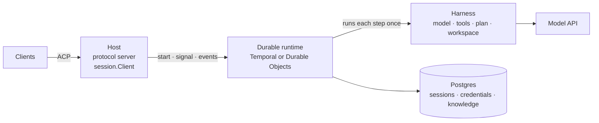

# Tacklr

[](https://github.com/Ryanaldo34/tacklr/actions/workflows/ci.yml)
[](https://github.com/Ryanaldo34/tacklr/blob/main/.testcoverage.yml)
[](https://pkg.go.dev/github.com/ryanaldo34/tacklr)
[](https://github.com/Ryanaldo34/tacklr/blob/main/go.mod)
[](https://github.com/Ryanaldo34/tacklr/blob/main/LICENSE)

Tacklr is a Go framework for AI agents that run as durable sessions. You give it a model and tools. Tacklr runs the agent loop and records every step, so a session can wait days for a person, survive a crash or a deploy, and continue on another machine.

## Features

- **Durable sessions.** Run sessions on [Temporal](https://temporal.io) or on Durable Objects (Cloudflare Workers). Each model request and tool call runs once, even across restarts.
- **Claude and OpenAI.** Use `anthropic` for Claude (the Claude API or Microsoft Foundry), `openai` for any endpoint that serves the OpenAI Responses API, or implement `tacklr.Model` yourself.
- **Focused context.** The agent plans its work as a to-do list. Finishing a to-do replaces the history with a short hand-off, and a full window collapses into a summary.
- **People in the loop.** A tool can pause the session to ask a question or a permission, and continue when the answer comes back.
- **A sandboxed workspace.** The agent sees one `/workspace` built from local disk, S3, Azure Blob, Google Drive, Microsoft 365, or Git, plus an optional shell that sees only that workspace.
- **A knowledge store.** Hybrid search, an optional graph, and namespaces for multi-tenant data.
- **Standard protocols.** Serve clients over [ACP](https://agentclientprotocol.com), connect [MCP](https://modelcontextprotocol.io) servers, and trace every turn with OpenTelemetry.
- **Small binaries.** Cloud adapters use plain HTTP instead of vendor SDKs, and the core builds for WebAssembly.

## Install

```bash
go get github.com/ryanaldo34/tacklr
```

Tacklr needs Go 1.27 or later and runs on Linux.

## Quick start

This program runs a Temporal worker and client in one process, sends one prompt, and prints the answer. Start a local Temporal server first with `temporal server start-dev` ([Temporal CLI](https://docs.temporal.io/cli)).

```go
package main

import (
	"context"
	"fmt"
	"log"
	"os"

	"go.temporal.io/sdk/client"

	"github.com/ryanaldo34/tacklr"
	"github.com/ryanaldo34/tacklr/anthropic"
	"github.com/ryanaldo34/tacklr/session"
	"github.com/ryanaldo34/tacklr/session/temporal"
	"github.com/ryanaldo34/tacklr/session/temporal/worker"
)

type cityArgs struct {
	City string `json:"city" desc:"City name"`
}

func main() {
	ctx := context.Background()

	weather := tacklr.NewTool(tacklr.ToolConfig{
		Name:        "get_weather",
		Description: "Return the current weather for a city.",
		Handler: func(ctx context.Context, args cityArgs) (string, error) {
			return "Sunny and 24°C in " + args.City, nil
		},
	})
	agent := tacklr.AgentOptions{
		SystemPrompt: "You are a helpful assistant.",
		Model:        anthropic.New(nil).WithApiKey(os.Getenv("ANTHROPIC_API_KEY")).WithModel("claude-opus-5-5"),
		Tools:        []*tacklr.Tool{weather},
	}

	c, err := temporal.Dial(client.Options{HostPort: "localhost:7233"})
	if err != nil {
		log.Fatal(err)
	}
	defer c.Close()

	// In-memory stores work when the worker and the client share a process.
	store, secrets := session.NewMemoryStore(), session.NewMemorySecretStorage()

	w := worker.New(c, worker.Config{Agent: agent, Store: store, Secrets: secrets})
	if err := w.Start(); err != nil {
		log.Fatal(err)
	}
	defer w.Stop()

	sessions := temporal.Open(c, temporal.Config{Store: store, Secrets: secrets})
	id, err := sessions.CreateSession(ctx, session.CreateSession{})
	if err != nil {
		log.Fatal(err)
	}
	events, err := sessions.Subscribe(ctx, id, 0)
	if err != nil {
		log.Fatal(err)
	}
	defer events.Close()

	if err := sessions.Prompt(ctx, id, session.Prompt{Text: "What is the weather in Lisbon?"}); err != nil {
		log.Fatal(err)
	}
	for ev := range events.Events() {
		switch ev.Type {
		case session.EventMessage:
			fmt.Println(ev.Content)
		case session.EventComplete, session.EventError:
			return
		}
	}
}
```

```bash
ANTHROPIC_API_KEY=... go run .
```

The model calls `get_weather`, Tacklr runs it, and the model answers from the result. To use OpenAI instead, set `Model` to `openai.New(nil).WithApiKey(key).WithModel("gpt-5-mini")`.

The [getting started guide](docs/getting-started.md) continues from here: asking the user a question, adding a workspace, and splitting the program for production.

## How it works



- A **host** is a stateless server. It talks to sessions only through `session.Client`, so it scales like any web service.
- The **runtime** keeps each session durable. On Temporal a session is a workflow, and each model request and tool call is an activity.
- The **harness** does the work of one step: it calls the model, runs a tool, or commits the result to the context window.

See [Concepts](docs/concepts.md) for sessions, turns, rounds, and the context window.

## Documentation

| Guide | Covers |
|---|---|
| [Getting started](docs/getting-started.md) | A first agent, questions to the user, next steps |
| [Concepts](docs/concepts.md) | Sessions, turns, rounds, plans, specialists, events |
| [Models](docs/models.md) | Claude, OpenAI and compatible endpoints, writing your own `Model` |
| [Tools](docs/tools.md) | Writing tools, permissions, built-in tools, MCP, skills |
| [Workspace](docs/workspace.md) | The agent's `/workspace`, its sources, files and documents, the shell |
| [Knowledge](docs/knowledge.md) | The knowledge store: kinds, search, the graph, file indexing |
| [Sessions in production](docs/session.md) | Temporal and Durable Objects, Postgres, credentials, specialists and jobs |
| [Protocols](docs/protocol.md) | The ACP server, a turn from prompt to answer, writing a protocol |
| [Context window](docs/context.md) | How each request is sized, collapsed, and cut |
| [Telemetry](docs/telemetry.md) | Traces, logs, and metrics for every turn |

API reference: [pkg.go.dev/github.com/ryanaldo34/tacklr](https://pkg.go.dev/github.com/ryanaldo34/tacklr).

## Examples

- [examples/temporal](examples/temporal): a production layout on Temporal, with an ACP host, a worker, Postgres, and an end-to-end test.
- [examples/cloudflare](examples/cloudflare): sessions as Durable Objects on Cloudflare Workers, with the same ACP server.

## Contributing

Read [AGENTS.md](AGENTS.md) for the coding and testing standards. Tacklr supports Linux only; on a Mac, use a Linux VM.

```bash
make cover   # all tests with the race detector, and the coverage gate
make lint
make wasm    # checks that the core still builds for WebAssembly
```

The tests start their own Postgres, Helix, Temporal, S3, and Azure Blob containers, so they need Docker, FUSE, and user namespaces.

## License

Apache 2.0. See [LICENSE](LICENSE).
