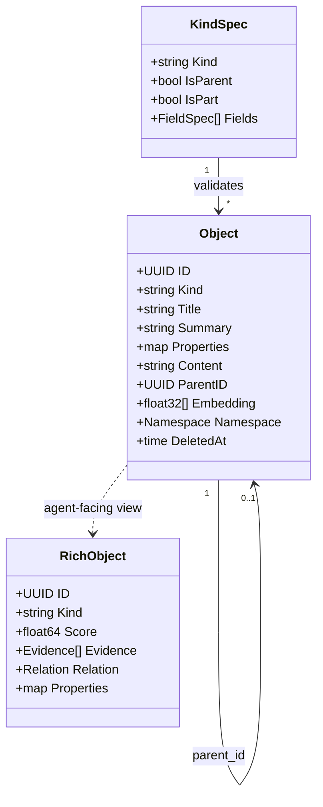
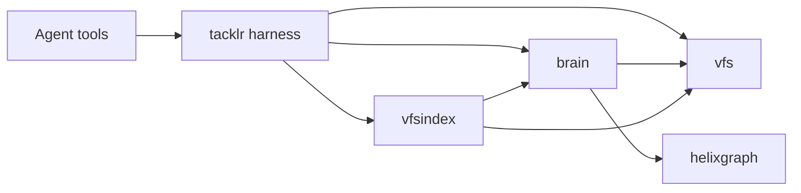
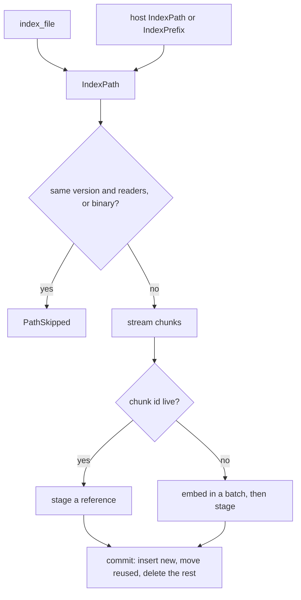
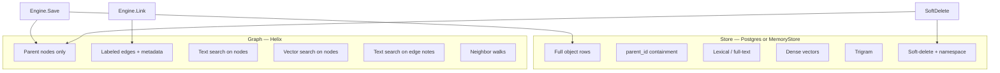
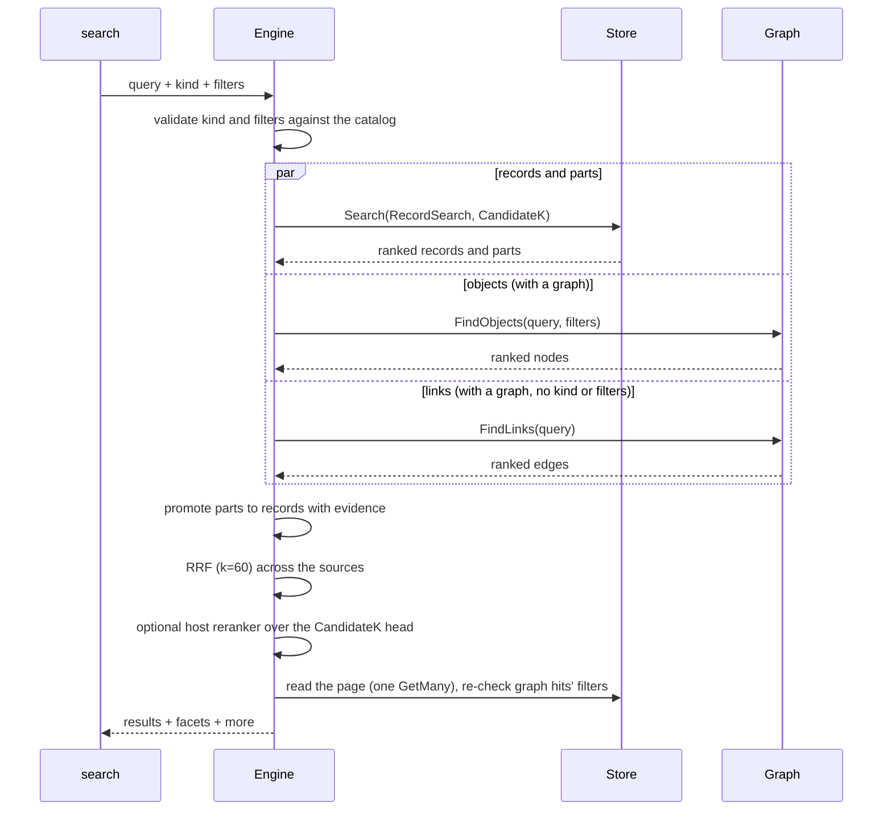
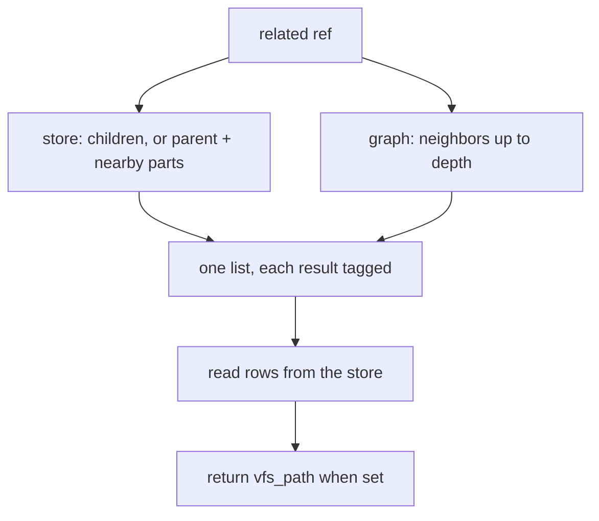

# Knowledge system (Brain)

This is the canonical guide to Tacklr’s knowledge base: how objects are stored, how
they appear as files, how search and the graph work, and how an agent is supposed
to use them. The engine is generic: inject a `brain.Store` and optional graph.
`brain/postgres` and `brain/helixgraph` are optional backends.

You do not need to have read the rest of the Tacklr codebase first. Terms are
defined as they appear, and again in the [glossary](#glossary).

**Related**

| Doc | When to open it |
|-----|-----------------|
| [docs/vfs.md](vfs.md) | Mounts, file IR, provider persist, index *policy* on a mount |
| [`brain` package](https://pkg.go.dev/github.com/ryanaldo34/tacklr/brain) | Go API reference |
| [`vfsindex` package](https://pkg.go.dev/github.com/ryanaldo34/tacklr/vfsindex) | Artifact → Document/Chunk ingest API |
| [README](../README.md) | How Brain fits the rest of the harness |

---

## Who this is for

| Reader | What you should take away |
|--------|---------------------------|
| **Host / product engineer** | How to register kinds, inject `postgres.Store` and optional `helixgraph.Graph`, and decide which workspace mounts to index |
| **Agent author / tool designer** | Which tool to call for which question; why `ls` never shows relationships |
| **Contributor** | Which package owns which job; what must not import what |

Tacklr is a Go **agent harness** (a framework, not a grab-bag of helpers). The
**host** is the application that constructs an agent. The **agent** is the model
plus the tools the harness injects. The **brain** is the host-owned knowledge
engine those tools call.

---

## Four jobs, kept separate

The knowledge system does four different jobs on purpose:

1. **First-class objects** (Engrams) live in a database and show up as Markdown files.
2. **Workspace files** (artifacts) stay on disk or S3; a derived index makes them searchable.
3. **Relationships** live in a graph. They are not files and `ls` never lists them.
4. **Retrieval** lands on a parent object, then you open the *live* file — not a stored chunk body.

Search is hybrid (keyword + vector), biased toward recently updated objects,
graph-aware when a graph is attached, and scoped to a namespace. The agent
queries when it needs a fact; the harness does not dump a static result list
into every prompt.

A plan handoff saves the exact context window as **session messages** in
`session_messages` before the window is replaced. Each row's namespace is the
host `SearchNamespace` with the session id appended as the last attribute
(`session`). `search` returns those messages together with
knowledge rows under the host namespace. Another session's tail is a different
namespace, so its messages are not in the page. `save` does not append the session attribute. Closing the session
deletes its session messages.

Session messages are not the harness checkpoint. The checkpoint
(`SessionCheckpoint`) is the live window the runtime saves and restores.
Session messages are earlier windows kept for search.

Compress and a specialist result may still write **Episode** objects (a summary
and capped discarded text) into the knowledge store. Those are not product kinds
(Fact, Memory, Discovery). Hosts with a non-empty catalog should register
`EpisodeKinds()` alongside `vfsindex.MountIndexKinds()`. A failed Episode write
does not block the window rebuild. A failed session-message save does stop the
handoff, and the live window stays.

---

## The two jobs (do not mix)

Almost every design mistake in this area comes from treating these as the same thing.

| Job | What it is | Source of truth | How it becomes searchable | What the agent edits |
|-----|------------|-----------------|---------------------------|----------------------|
| **Knowledge record** | A host-defined record: a Deal, Person, Fact, Memory, … | A row in the brain **store** | `save` or `Engine.Save` writes the row. `search` reads it | The record itself (`open`), not a file |
| **Artifact** | A normal file the agent is working on | Bytes on local disk, S3, or a bound Drive/Graph folder | **IndexPath** copies a Document + Chunks into the store | `/workspace/work/contract.md` or `/workspace/contracts/nda.pdf` |

```text
  Agent
    ├─ file tools     read, write, run_command
    └─ knowledge tools search, open, related, save, link
              │
         MountSession          ← files only
    ┌─────────┴──────────────┐
    ▼                        ▼
  Local                  S3 / Drive / Graph
  /workspace/work        /workspace/…
    │
    │ IndexPath (optional, hash skip)
    ▼
              brain.Engine   ← save / search, no file mount
         ┌────────────┬──────────────┐
         │ Store      │ Graph        │
         │ Postgres   │ Helix        │
         │ or memory  │ (or another  │
         │            │  graphtest   │
         │            │  backend)    │
         │            │              │
         │ full rows  │ parent nodes │
         │ text+vector│ + edges      │
         │ children   │ (no chunks)  │
         └────────────┴──────────────┘
```

**Rule:** a knowledge record is already an object. Do not also store it as a workspace file and index that file. Search would return the body twice.

---

## What the agent sees

The agent never sees a host filesystem path, a bucket key, or a SQL row.

It sees:

- **Virtual paths** such as `/workspace/work/main.go` for files. Knowledge records are ids, not paths
- **Tools** the harness injects when the host wired Brain (and, for file tools, VFS)
- **Rich objects** from search: id, kind, title, score, optional evidence, optional `vfs_path`

A **virtual filesystem (VFS)** is one tree of paths whose backends the host chose.
Local disk, S3, Drive, and Graph look the same at the file-tool layer. Knowledge does not. Details:
[docs/vfs.md](vfs.md). Workers share the host `MountSession` and brain engine;
they do not get a second FUSE.

Relationships do **not** appear as files. There is no `.links` directory.
`run_command` → `ls` shows file names only. To see neighbors, the agent calls
`related` with an object id or an indexed path.

---

## Object model

Everything in the store is one **object**. Kind and `parent_id` decide the role.



| Role | How you recognize it | Appears as a file? | In the graph? |
|------|----------------------|--------------------|---------------|
| **Parent / Engram** | `parent_id` is empty | Yes — `{slug}.md` | Yes (dual-written on `Save`) |
| **Part / Chunk** | `parent_id` is set | Never | Never |

Parts are not files. `search` looks at parts (indexed workspace files, or
chunks the host writes with `PutTree`). The Engram Markdown body lives
on the parent, and `search` matches the parent by its own text too.

**Kinds** are defined by the **host**, not by Tacklr. `Deal` and `Person` in tests
and examples are sample product types, not SDK types. You register them with
`ApplyKinds` / `WithKinds`.

- **Empty catalog** (“open mode”): any kind name and any properties are accepted.
- **Non-empty catalog**: unknown kinds are rejected; required fields must be
  present; unknown property keys fail the write.

Kind names must be path-safe: no `/` and no `..`. Only **parent** kinds become
directories.

Every durable object belongs to a **namespace**: ordered named attributes
(for example `org=acme`, `workspace=west`). `AgentOptions.SearchNamespace` is the
host ceiling. Each brain tool call may pass extra `namespace` attrs to narrow
that search; it cannot change the host's values. Continue uses the namespace
stamped on the result set. The first attribute is the **tenant**: a scope
reaches a row only when the row has the same first attribute, and every other
scope attr is on the row (`Covers`). Matching attrs in another tenant, or the
same attrs in another order, reach nothing. Every store enforces the tenant by
equality: a generated, indexed `tenant` column in Postgres, and tenant-scoped
text, vector and edge indexes in Helix, so search ranks one tenant only.
Wrong-namespace looks like not-found.

---

## Packages and ownership



| Package | Owns | Must not |
|---------|------|----------|
| `vfs` | Mounts, bytes, document IR, `IndexPolicy` as a string | Import `brain` |
| `brain` | Objects, search, graph ports | Import the harness or `vfs` |
| `vfsindex` | Artifact → Document/Chunk pipeline, schedulers, policy helpers | Be required to use VFS or Brain alone |
| `brain/helixgraph` | Helix client behind graph interfaces | Leak Helix types into tools |
| `tacklr` (harness) | Knowledge tools and file tools | Own parse/index internals |

`vfs` and `brain` work alone. `vfsindex` indexes workspace files into the brain and is the package that imports both.

---

## Writing knowledge

`save` calls `Engine.Save` with a kind the host allows (`AgentOptions.BrainWriteKinds`). The title is required. `id` updates that row. `open` and `search` return it. Indexed workspace files still store `vfs_path` so `open`, `related` and `link` can take a path. A knowledge record has no path.

```mermaid
sequenceDiagram
    participant Agent
    participant E as Engine
    participant S as Store
    participant G as Graph

    Agent->>E: save / Save
    E->>E: ValidateObject
    E->>E: choose the index text
    E->>S: Put(Indexed{object, text}) — the store embeds the text
    E->>G: Put(Indexed{object, text}) — parents only; the graph embeds the text
    Note over E: Fail closed: unknown field, missing required property, or text that does not embed → no leftover row
```

IR edits (`write` / `WriteDocument`) persist the same way:
the serialized Markdown is parsed and saved.

### Artifacts — the file stays where it is

A file on a mount is not a knowledge record. Indexing makes a mirror in the
store so `search` can find it.

```text
/workspace/work/contract.md     ← live bytes (source of truth)
        │
        ▼ IndexPath  or a host pipeline that writes the same rows
  Document   id = DocumentID(scope, path)
             props: vfs_path, source_version, size, mtime, media_type
    ├─ Chunk  about 2 KiB    start_line, end_line, byte_start, byte_end
    └─ Chunk  heading block  block_id, heading_path
```

A pipeline that can import this module should call `MountIndexer.IndexPath` or `Engine.Save`. Those calls embed the row and, for a parent, update the graph node. The tables below are the row contract for a writer that does not call them. A raw store insert that skips `Save` does not embed and does not update the graph, so `search` will not see it.

### File mirror rows

Kinds default to `Document` (parent) and `Chunk` (part). `MountIndexKinds()` registers those names and the properties below. `MountIndexer.DocumentKind` and `ChunkKind` can rename them. A pipeline must use the same names the engine was given.

`DocumentID` is the stable parent id. `Namespace.String()` joins the scope's attribute values with `.` (names are not included). The id is UUID version 5 (SHA-1) using namespace `a1b2c3d4-e5f6-7890-abcd-ef1234567890` and the name `namespaceString`, a zero byte, then the absolute virtual path:

```go
ns := uuid.MustParse("a1b2c3d4-e5f6-7890-abcd-ef1234567890")
buf := append([]byte(scope.Namespace.String()), 0)
buf = append(buf, []byte(virtualPath)...)
id := uuid.NewSHA1(ns, buf)
```

In-process code should call `MountIndexer.DocumentID` instead of copying that. The same path in another namespace is a different id. `open`, `related` and `link` resolve a workspace path by the parent row whose `vfs_path` it is.

Chunk ids come from content. `Engine.PutTree` computes each id from the parent id and the chunk's kind, content type, title, summary, content and index text. The model is not in the id: a store re-embeds a live chunk only when its embedding came from another model. A repeated chunk text in one file gets a counter, so each id stays unique. A chunk with the same text keeps its id, row and vector across re-indexes. Line numbers are not in the id or the title, so a chunk that only moves keeps its id too. A writer outside this module cannot reproduce these ids; it must call `PutTree` with parts that have no id.

Parent row (`Engine.Save`):

| Field | Value |
|-------|--------|
| `id` | `DocumentID` |
| `kind` | `Document` |
| `title` | Base name of the virtual path (`contract.md`) |
| `summary` | Absolute virtual path |
| `content` | Empty. The body lives on the chunks. |
| `content_type` | Media type (`text/markdown`, `text/plain`, …) |
| `parent_id` | Unset |
| `properties.vfs_path` | Absolute virtual path, string |
| `properties.source_version` | `vfs.FileInfo.Version` when the file was read. Omitted when the backend gives no version. |
| `properties.size` | `FileInfo.Size` as a number |
| `properties.mtime` | UTC `time.RFC3339` from `FileInfo.ModTime`. Omitted when the mod time is zero. |
| `properties.media_type` | Same string as `content_type` |

`vfs_path` is omitted from the parent's graph search text (`EntityIndexText`). `MountIndexKinds` also marks `source_version`, `size` and `mtime` `SkipIndex`, so they do not change the parent's embedding.

Chunk row, one per chunk or block, in order:

| Field | Value |
|-------|--------|
| `id` | Content id (see above) |
| `kind` | `Chunk` |
| `parent_id` | The Document id |
| `position` | 0-based index in the file's chunk list. This is list order, not the start line. |
| `content` | Chunk text. This is what `search` matches. |
| `title` | Empty for a plain-text chunk. Heading block: `contract.md#` plus the block id. |
| `properties.start_line`, `end_line` | 1-based inclusive line numbers, stored as numbers |
| `properties.byte_start`, `byte_end` | Half-open byte range in the file (in the block text for a projected document) |
| `properties.block_id`, `heading_path` | Set only for a structured block. Both strings are the block id (`title/install`, `preamble`). |

**How a file is chunked.** Plain text and code stream from `OpenFile`: the file is never held in memory whole. Content-defined chunking picks each boundary: a rolling (Gear) hash over the last 64 bytes marks a cut point, and the chunk ends at the next line end. A boundary depends only on the bytes near it, so an edit changes the chunks around it and the other chunks keep their text. `MountIndexer.Chunking` sets the sizes (`DefaultChunkSizes`: 1 KiB minimum, 2 KiB average, 8 KiB maximum, about 500 tokens a chunk). A chunk that reaches the maximum ends at its last line end, or inside the line, on a rune boundary, when it has no line end. Blank chunks are dropped. A file larger than `MaxIndexBytes` (64 MiB) is indexed up to that size.

Markdown, Docs and Sheets need their block tree, so `IndexPath` reads them whole with `ReadText`, up to `vfs.MaxReadFileBytes` (32 MiB). Each block is one chunk; a block larger than the maximum chunk size is split with the same chunker. A structured file that `ReadText` cannot read (for example, a Markdown file over 32 MiB) streams as plain text.

**When a file is read.** `IndexPath` compares `FileInfo.Version` (an ETag, a content tag, or size, mtime and inode on disk) and the readers with the stored parent. When both match, it returns `PathSkipped` and does not open the file. When the backend gives no version, the file is read every time; unchanged chunks then write nothing.

**How a re-index writes.** `PutTree` streams the chunks to the store with their content-derived ids. The store embeds only chunks whose id is live under another model or not live at all, in batches of its `Embedding.BatchSize` (128), with at most `Embedding.Concurrency` (2) batches at a time (`Embedding.EmbedBatches` does this for any backend). Each batch is staged as it finishes. One short commit then makes the staged chunks the parent's only parts: it inserts the new chunks, moves the reused ones (position and line numbers), and deletes the rest. Until the commit, `search` sees the previous chunks. A failure leaves them in place. A one-line edit therefore embeds and writes about one chunk, whatever the file size, and memory holds a few batches plus the live chunk ids. When two indexers write one file, the one that commits second gets `ErrConflict`, and `IndexPath` reads the file again (up to three times).

A missing file soft-deletes the parent and its chunks (`PathRemoved`). A binary file is left unchanged (`PathSkipped`).



The parent holds metadata and `source_version`, not a second copy of the file. After search, the agent opens the live path with `read` using `vfs_path` plus `start_line` or `block_id`.

**Index policies** (set on the mount; empty means `selective`):

| Policy | When indexing runs |
|--------|--------------------|
| `none` | `index_file` returns an error. |
| `selective` | `index_file` or a host `IndexPath`. A later write does not re-index the file. |
| `prefix` | Hint for a host pipeline that walks the mount. The turn does not. |
| `watch` | Same hint as `prefix`. The turn does not subscribe to the remote system. |

Knowledge records are not this schema. The host registers their kinds. `save` calls `Engine.Save` with the title required and the host's properties. `search` matches a parent by its own text, so a record with no chunks is found too. A pipeline for those records follows the host `KindSpec` and `Engine.Save`, not `Document` / `Chunk`.

---

## Two backends: store and graph

They are complementary. The store is the document corpus and the source of
truth. The graph is tracked records and how they relate. Do not treat Helix as
a second document database.

**Who does what.** Backends own retrieval. Each backend embeds with its own
`brain.Embedding`, picks its channels, ranks and fuses them, applies filters,
and returns only what the caller's namespace and principals can read. The
engine owns orchestration and the domain rules: it validates requests and
scopes, keeps the kind catalog, chooses the text that represents each object,
derives part ids from content, writes the store and then every index and then
the audit, fuses the sources' lists, reads every result from the store (which
drops rows that are deleted or that the caller cannot read), promotes part hits
to their records, pages, runs the optional reranker, and computes facets.

**One engine, the graph is a component.** `brain.NewEngine(store,
brain.WithGraph(g))` adds a graph; without it the engine is store-only. The
graph is a source, not a feature switch: `Search` and `Related` take what the
graph adds when there is one and return the store's results when there is
not. Only `Link` needs a graph and returns `ErrUnsupported` without one, and
the harness registers the `link` tool only when `Engine.HasGraph()`. Every
committed write of a first-class object goes to the store, then the engine's
indexes (`brain.Index`: `Put`, `Remove`, `Erase`; a graph is one), then the
audit. `brain.WithIndex` adds other indexes (a second search system, a change
feed).

Each side is one required interface:

```go
type Store interface {
    Get, GetMany, GetByProperty
    ListChildren(ctx, scope, parentID, limit int) ([]Object, error) // limit ≤ 0: every part
    Put(ctx, scope, Indexed) (Object, error)
    PutTree(ctx, scope, parent Indexed, parts iter.Seq2[Indexed, error]) (Object, error)
    SoftDelete, PurgeDeleted, Erase
    Search(ctx, scope, RecordSearch) ([]ScoredID, error) // ranked records and parts, best first
    GetKind, ListKinds, PutKind
    SaveSessionMessages, DeleteSessionMessages, PurgeSessionMessages
}

type Index interface {
    Put(ctx, Indexed) error                                // parents only
    Remove(ctx, id) error
    Erase(ctx, scope) error                                // idempotent
}

type Graph interface {
    Index
    Link(ctx, GraphEdge) error                             // ErrNotFound if a node is missing
    Unlink(ctx, from, to, rel) error
    FindObjects(ctx, ObjectSearch) ([]ScoredID, error)     // filters before ranking
    FindLinks(ctx, LinkSearch) ([]EdgeSearchHit, error)    // empty relation: every indexed relation
    Neighborhood(ctx, NeighborhoodQuery) ([]GraphNeighbor, error) // empty Relations: every relation
}
```

`Indexed{Object; Text}` is an object plus the text the engine chose for it. A
backend indexes that text its own way. A method a backend cannot support
returns `ErrUnsupported`.



| | Store | Graph |
|-|-------|-------|
| **Holds** | Full rows, chunks, embeddings, filters | Parent nodes + edges |
| **Search source** | Records and parts (title, summary, body) | Parent records (title, summary, indexed properties, body) and edge notes |
| **Related source** | Children; a part's parent and nearby parts | Records the relations reach |
| **Required?** | Yes | Optional. Without one, search and related use the store only and there is no `link` tool |

`RecordSearch` ranks **records and parts** together: a record matches on its
own title, summary and body, and a part's hit carries its `ParentID`. Filters
always test the **record**: a part passes when its parent does, so a kind or a
property filter means the same thing on every source. The engine promotes part
hits to their record with evidence, and a record scores its own hit plus the
sum of the evidence it keeps.

The graph's `FindObjects` looks at **parent** nodes: the record's title,
summary, body, and indexed properties. Structured fields belong in **filters**,
not in the query string.

Exact lookups (`Get`, `Resolve` by `vfs_path`, a UUID query) always go to the
store.

**Write rules**

- Only **parents** become graph nodes. Chunks never go to the graph.
- `Save` upserts the node **in place** so existing edges survive. If the graph
  write fails after the store write, the row stays (store is source of truth);
  retry `Save` after fixing the graph.
- `SoftDelete` removes the **graph node first**, then marks the row deleted.
  If the store delete then fails, a later `Save` recreates the node.
- Graph results are ids; the engine reads the full rows from the store under
  the current namespace. Ids that are missing or out of scope disappear.

**What text represents an object** (the engine chooses it; each backend embeds
it with its own `Embedding`, and each backend's vector dimension is its own
option):

| Object | Text |
|--------|------|
| Parent / Engram | `EntityIndexText`: title, summary, indexed scalar properties, full body |
| Part / Chunk | `IndexText` (title + summary + content), prefixed with the parent title |

`WithIndexText` can rewrite that text at Save (prefix, replace, or drop fields)
without changing the stored object. The store and the graph get the same
string.

So a search for `open renewal` can match a Deal whose `stage` property is
`open` through the graph, not only the narrative body.

`helixgraph.Open` creates the Helix indexes and waits until they are active, so
object search is on as soon as it returns. Opens that race on one server, and
writers that conflict, are replayed until they land or the context ends.

Tests run against live Helix (`internal/helixtest`). `make test` and CI start one
server for every package through `scripts/with-helix.sh`, which sets
`TACKLR_HELIX_URL`; a package run alone starts its own container. A fresh server
builds each index once, which is most of the graph tests' time.

---

## Search: one ranked list

`search` is the one way to land. It takes free text, an optional `kind`, and
`filters`, and returns one ranked list of records and links.



- **A UUID query** returns that object.
- **A query in double quotes** is matched literally: the store's exact
  channels (lexical and trigram, exact title first), no embedding, no graph.
- **Otherwise** the sources run at once. A graph error is logged and the
  page comes from the store, unless `EngineConfig.FailOnGraphError`.
- **Links** rank only when the request has no kind and no filters, since a
  link has neither. A link result names both ends, the relation and the note.
- **No query, with a kind or filters,** lists the matching records newest
  first, from the store (`RecordSearch` with an empty `Query`; Postgres reads
  it from an index on tenant and `updated_at`), paged with `more`. No query,
  no kind and no filters fails with the choices.
- **`within`** (a record, a part of it, or an indexed file path) searches only
  that record's parts: each result is a part with the snippet that matched.
  Only the store runs (`RecordSearch.Within`; no session messages): the
  graph's objects and links are other records, so they do not apply.
  `within` needs a query; `related` lists a record's parts.

Hits are often **chunks**. The engine does **not** return those chunks as the
primary result. It **promotes** them to their record and attaches the best
chunks as **evidence** (snippet, score, `start_line`, `block_id`).

Production defaults (not per tool call): the engine asks each source for 40
candidates (`EngineConfig.CandidateK`) and keeps 3 evidence quotes of 240
characters, page size 10 (max 50). The engine fuses the sources with plain
RRF, `k=60`: it ranks by position in each list, so the backends' scores,
which are not comparable, need no normalising, and there is no weight to
tune. The store's own `brain.Ranking` uses RRF `k=60` and no age
decay (`Decay` 0). A host sets `Ranking.Decay` above 0 on the store or the
graph when a newer write should outrank an older one. `updated_at` is the last
write, not an expiry. Equal scores still prefer the newer row.

Indexed file recall is the same pipeline via `search` (prefer hits with
`vfs_path`). That is not a behavior-preserving stand-in for live `rg`.
Live grep is `run_command` → `rg`.

### Kinds, filters and teaching errors

The tools put the registered record kinds in the JSON schema as an enum on
`kind` (part kinds are left out: a part is found through its record). There
are no field lists in the schema: `open` shows a kind's fields, and every
page's **facets** name the kinds and the common field values among its
objects (with a catalog, only the kind's declared fields).

Filter map keys:

- Core: `kind`, `title`, `created_after`, `created_before`, `updated_after`, `updated_before`
- Anything else: an object **property**. When the catalog is non-empty, the key
  must be listed on that kind, and a kind is required.

A wrong kind or filter fails with an error that names the valid choices:
`unknown kind "Phase"; kinds: Deal, Fact`, `filter "stage" needs a kind; kinds:
…`, `unknown filter "phase" for Deal; filterable: stage, …`.

### `more`

Every page says whether there is `more`. The page carries a `Rest` (the
remaining ids, scores, evidence and filter, no rows), which `Engine.Next`
pages through. The tools keep each tool's last `Rest` in the session's
`SearchContext`, and `more: true` on `search` or `related` returns the next
page of that tool's last call. The context is checkpointed with the agent
thread, so `more` works after a restore.

---

## Related: containment and relations

Two different meanings of "neighbor", one tool:

| Kind | Stored as | `relation` on the result | Example |
|------|-----------|--------------------------|---------|
| **Containment** | `parent_id` on the store row | `child`, `parent`, `sibling` | Document → its Chunks |
| **Relation** | A labeled graph edge | the edge's label, with its direction and note | Deal → Person, `has_contact` |



- With no `relation`, `related` returns containment and every graph relation.
  `relation: "contains"` keeps containment only (results still say `child`,
  `parent` or `sibling`); any other label keeps that graph relation only.
- Default depth is 1 hop (capped at `MaxExpandHops`, 4). Each graph hop
  names the object it came through (`via`), so one `related` call with a
  depth gives the path from the start to every object it reaches.
- Without a graph, `related` returns containment.
- `ls` never lists edges. Tool descriptions say this on purpose.

`link` requires both ends to exist in the namespace, not be soft-deleted, and
**not** be parts, and refuses the containment relations. `remove: true` drops
the edge. Paths resolve through `vfs_path`. An unindexed `/work/doc.md` cannot
be linked until `index_file` (or a prefix policy) has created a Document id.

The optional `note` is indexed by the graph (text and, with an embedder,
vector), so `search` finds the link by what it says. With Helix, a relation
must be in `helixgraph.Options.EdgeRelations` for its notes to rank.

---

## Agent tools

Injected when the host sets `AgentOptions.Brain` (file-backed tools also need
VFS + a search namespace). The engine is closed into the handlers at construct,
same as any other tool client. Isolated VFS with no Brain: file tools only.

| Tool | Use it when | Backs onto |
|------|-------------|------------|
| `search` | You need facts: records, indexed files, links, earlier messages | `Engine.Search` / `Engine.Next` |
| `open` | You have an id or an indexed path and need the whole object and its kind's fields | `Engine.Open` |
| `related` | You have a record and need its parts, parent or linked records | `Engine.Related` / `Engine.Next` |
| `save` | You want a durable knowledge record (kinds from `BrainWriteKinds`) | `Engine.Save` |
| `link` | You are asserting or removing a relationship (graph only) | `Engine.Link` |
| `read` / `write` | You are editing a workspace file | VFS |
| `index_file` / `unindex` | You must (un)mirror an artifact | `IndexPath` |
| `run_command` | You need live `ls` / `fd` / `find` / `rg` on the FUSE tree | Host shell, cwd = `HostDir` |

`search`, `open` and `related` take an optional `namespace` that narrows the
host namespace for one call. `save` is registered only when
`AgentOptions.BrainWriteKinds` names a kind, and its `kind` is an enum of
those kinds.

### Suggested loop

```text
search                                    ← land (facets show kinds and fields)
    │
search with kind + filters                ← narrow
    │
related  /  open                          ← walk, read in full
    │
read on vfs_path                          ← live bytes, not the chunk snapshot
```

---

## A concrete walkthrough

The host registered kinds `Deal` and `Person` and wired Postgres + Helix.

1. `save` (or `Engine.Save`) writes the Deal and the Person. Each save upserts a graph node.
2. `link from=<deal> to=<person> relation=has_contact note="signs the renewal"`
3. `index_file /workspace/work/nda.md` creates a Document + Chunks with `vfs_path`. A later write with the same hash is skipped.
4. `link from=/workspace/work/nda.md to=<deal> relation=about` fails until step 3, because an unindexed file has no object id.
5. `search "acme renewal"` returns the Deal (store and graph agree), the NDA's chunks as evidence on the Document, and the `has_contact` link by its note.
6. `related ref=<deal> relation=has_contact` returns the Person.
7. `search "indemnity" kind=Document` narrows to indexed files.
8. The agent calls `read` on the NDA path from that evidence. The live file is not the chunk snapshot.

---

## Wiring it as a host

Minimum (in-memory, no graph, no files):

```go
store := brain.NewMemoryStore()
eng, err := brain.NewEngine(store, brain.WithKinds(
    brain.KindSpec{Kind: "Fact", IsParent: true, Fields: []brain.FieldSpec{
        {Name: "topic", Type: brain.FieldTypeString},
    }},
))
// AgentOptions{Brain: eng, BrainWriteKinds: []string{"Fact"}, ...}  → search / open / related / save
// The harness closes `eng` into those tool handlers (same pattern as host tools).
```

Production-shaped. `postgres.Store.Setup` creates whatever schema is missing,
then upserts the kinds you pass. Run it on each deploy; concurrent runs wait for
each other on an advisory lock. `postgres.Open` takes the
connection string and `Options`: `EmbeddingDim` must match the embedder (zero
means 1536), and Setup fails when the existing vector column has another size.
`Schema` names the schema (default `tacklr`); every connection's `search_path`
is that schema, then `public`, with a server-side `statement_timeout`
(`StatementTimeout`, default 30s). Pool settings ride in the connection string
(`pool_max_conns`, …). A
transaction-mode pooler (port 6543 on hosted Postgres) must support prepared
statements and forward those startup parameters; otherwise use 5432.

Lexical search reads the stored `search_tsv` column on `objects`: title weight A, summary weight B, body weight C. A partial GIN index covers live parts. Rank is `ts_rank_cd` with normalization 32. The first query is `websearch_to_tsquery` (every term). A page shorter than requested runs a second query that ORs those terms. Vector search uses HNSW. Namespace containment, child listing, and parent-by-kind each have one index. Property filters, trigram similarity, and created/updated ranges do not: those predicates are applied on top of the index the query already uses. Session messages stay on their unique keys. `pg_trgm` and `pgvector` are always created.

Helix is an optional graph. Inject both; `brain` does not import either package.

```go
// Each backend embeds with its own Embedding; they can share one Embedder.
emb := brain.Embedding{Embedder: myEmbedder} // Embed(ctx, texts) and Model()

store, err := postgres.Open(ctx, os.Getenv("DATABASE_URL"), postgres.Options{
    EmbeddingDim: 1536, // schema "tacklr"
    Embedding:    emb,  // nil Embedder: keyword search only
})
defer store.Close()
kinds := append([]brain.KindSpec{dealSpec, personSpec}, vfsindex.MountIndexKinds()...)
if err := store.Setup(ctx, kinds...); err != nil { /* ... */ }
client, err := helix.NewClient(helixURL)
// Open creates the indexes (text and vector per tenant, edge indexes per
// relation) and waits until they are active.
g, err := helixgraph.Open(ctx, client, helixgraph.Options{
    Dimension:     1536,                           // must match the embedder
    EdgeRelations: []string{"about", "has_buyer"}, // relations whose notes search ranks
    Embedding:     emb,                            // nil Embedder: text only
})

eng, err := brain.NewEngine(store, brain.WithGraph(g)) // graph results in search and related; the link tool
// Model() names the model each backend stores with every vector; a backend
// compares only vectors from the same model.
if err := eng.LoadKindsFromStore(ctx); err != nil { /* ... */ }

// AgentOptions:
//   Brain:           eng
//   BrainWriteKinds: the kinds the save tool may write (none: no save tool)
//   SearchNamespace:  from brain.ParseNamespace("org", orgID) (required with Brain)
//   SearchPrincipals: the caller's user and group ids (checked against Readers)
//   IndexReaders:     a file's source ACL for index_file (optional)
//   OpenVFS:         workspace files only. Knowledge is not a mount.
//
// A turn with Brain, a workspace, and SearchNamespace registers index_file
// and unindex. It does not re-index writes or subscribe to Drive or bucket
// events. The host's own pipeline keeps brain rows current.
```

Optional knobs: `WithReranker(func(ctx, query, objects))` (reorders or drops the objects among the first `CandidateK` results for the query, before the page cut; without it, the fused order stands),
`WithIndex` (another index), `WithConfig` (`CandidateK`, `EvidenceN`, `SnippetCap`, `DefaultLimit`, `MaxLimit`, `SiblingRadius`, `GraphNeighborK`, `MaxExpandHops`, `MaxResultSetSize`, `FailOnGraphError`).
Ranking knobs live on the backend that ranks: `brain.Ranking` (`RRFk`, `Decay`)
on the store and on the graph.

For tests and offline hosts, `brain.NewMemoryStore(brain.WithMemoryEmbedding(emb), brain.WithMemoryRanking(r))`
is the whole `Store` in process; without an embedder it ranks words only.

Integration tests that need real backends use Testcontainers (Postgres image
under `brain/testdata`, Helix through `internal/helixtest`). They skip when
Docker is unavailable. Tests call `store.Setup` (embedding dim 3) instead of
loading SQL files.

---

## Writing a backend

A backend is one type that implements `brain.Store` or `brain.Graph`. The
engine gives it whole requests (a search with its query, filters and scope; a
tree with all its parts) and trusts its answers, so a database with native
hybrid search, filters or embedding can use them directly. Where a database
lacks a feature, the backend fills it in its own code. `brain` exports the
pieces for that:

| Gap in the database | Helper |
|---------------------|--------|
| No batching or bounded embedding | `brain.Embedding`: `Embed`, `EmbedOne`, and `EmbedBatches(ctx, parts, reuse, stage)`, which embeds a stream of parts in bounded concurrent batches, skips the ids `reuse` reports, and hands each batch to `stage` |
| No hybrid fusion or recency decay | `brain.Ranking`: `Fuse(lists...)` and `FuseEdges(lists...)` (decay by `UpdatedAt`, then RRF) |
| No native filters | `f.Compile()` (a `brain.Filter`) → `FilterPlan`: `Match(obj)` evaluates the filter in process, `Conditions()` lists the field, operator and values to translate into the database's own predicates, and `FilterValueKey` gives a typed key for a property value |
| No scope or readers check | `Scope.CanRead(obj)` and `Namespace.Covers` give the rule every backend applies |

A backend proves itself with the contracts: `storetest.Run(t, newStore)` and
`graphtest.Run(t, newGraph)`. Each runner passes the backend a test embedder
(or nil for text only) and checks outcomes: tenants and readers, filters before
ranking, atomic trees and part reuse, conflicts, embedding failures, and fused
search. `MemoryStore`, `postgres.Store` and `helixgraph.Graph` pass them.

---

## Isolation and failure modes

| Situation | Behavior |
|-----------|----------|
| Empty namespace | Every Engine and store call fails with `ErrInvalid`. `AgentOptions.Validate` rejects `Brain` without `SearchNamespace`. |
| Wrong namespace | `Get` / search look like not found. Graph ids that fail hydrate are dropped. A coarser scope (fewer attrs) in the same tenant sees objects with extra attrs; another tenant sees nothing. |
| Id held by another tenant | `Save` / `PutTree` / `SoftDelete` return `ErrNotFound` and change nothing. |
| Object with `Readers` | Visible only to a scope whose `Principals` include one of them. `vfsindex.MountIndexer.Readers` (or `AgentOptions.IndexReaders`) sets them from source sharing; a sharing change re-indexes the file. The graph node carries the readers too. For a caller who cannot read the object, the graph does not rank it or an edge that touches it, and `related` does not walk through it. A tenant-wide search still ranks from the index while at most `helixgraph.Options.MaxOverfetch` (256) such objects or edges are in the tenant; past that, Helix ranks within the readable candidates. |
| Re-index fails midway | `PutTree` stages new parts, which no read or search sees, and swaps them in with one short commit, so the previous version stays. `PurgeDeleted` drops staged parts that never committed. |
| Two writes of one tree | The commit that reads an older tree revision returns `ErrConflict` and changes nothing. |
| Embedding model change | A backend's vector search only compares rows from its `Embedder.Model()`. Rows from the old model drop out of the dense channel, and the next re-index embeds those parts again. |
| Retention and erasure | `PurgeDeleted`, `PurgeSessionMessages`, and `Erase` hard-delete under a scope. `Erase` erases every index (the graph) by scope first, then the store, so a failed erase leaves the store intact and running it again finishes the erase everywhere. |
| Audit | `WithAudit(store.Record)` records every served read and write; a failed record fails the operation. |
| Soft-deleted object | Hidden from Get, open, search, and related. `unindex` does this for an indexed file. There is no separate expired flag. A row stays in search until that delete, or until a property filter excludes it. |
| No embedder | A backend without an `Embedder` ranks words only. |
| Embedder down at **query** time | The backend logs the error and answers by the query's words. |
| Embedder down at **Save** time | **Fail closed.** The write fails and leaves no unindexed row. A session-message save still saves, without vectors. |
| Graph down at search or related | The error is logged and the store's results return, unless `FailOnGraphError`. |
| No graph | Search and related use the store only. `Engine.Link` returns `ErrUnsupported` and the `link` tool is not registered. |
| Index write fails after the store write | The row stays (source of truth) and the write is audited; the error wraps `ErrIndexPut` (or `ErrIndexRemove` for a delete, which leaves the row). Save again after fixing the index. |
| Invalid `Save` | Validate error; no leftover object. |

---

## Contributor map

| Area | Start here |
|------|------------|
| Object + search types | `brain/types.go` |
| Engine construct / config | `brain/engine.go` |
| Search, source fusion | `brain/search.go` |
| Pages, facets, `Next` | `brain/results.go` |
| RRF + temporal decay for backends (`Ranking`) | `brain/rank.go` |
| Batched embedding for backends (`Embedding`) | `brain/embed.go` |
| In-process filter evaluation (`FilterPlan`) | `brain/filter_plan.go` |
| Parent promotion + evidence | `brain/promote.go` |
| Open / Resolve / Get | `brain/open.go` |
| Related | `brain/related.go` |
| Save / Link / index text | `brain/write.go` |
| Kind catalog | `brain/kind.go` |
| Store interface | `brain/store.go` |
| In-process store | `brain/memory.go` |
| Store backend contract | `brain/storetest` |
| Postgres store | `brain/postgres` (`postgres.Open`, `Store.Setup`) |
| Graph interface | `brain/graph.go` |
| Graph backend contract | `brain/graphtest` |
| Helix adapter | `brain/helixgraph/` |
| Artifact indexer | `vfsindex/indexer.go` |
| Index policy + bridge | `vfsindex/policy.go`, `vfsindex/bridge.go` |
| Knowledge tools | `tools_brain.go` |
| Index tools | `tools_vfsindex.go` |

Tests are outcome-oriented integration tests (in-memory Engine + local VFS
jail). We assert what *should* happen (write visible as an object, related
returns paths), not that a private helper was called.

---

## Out of scope for this version

- Sidecar link files or virtual neighbor directories (`ls` is never a graph query)
- Hardcoded product types (Deal, Person, …) inside the SDK
- Agent-defined kinds (hosts own the schema for determinism)
- A VFS mount of knowledge records
- Indexing the brain Provider mount as Document/Chunk artifacts

---

## Glossary

| Term | Meaning |
|------|---------|
| **Host** | The application that constructs the engine, kinds, mounts, and agent |
| **Agent** | The model plus harness-injected tools |
| **Brain / Engine** | The knowledge facade: search, open, related, save, link |
| **Store** | Durable object rows (Postgres or in-memory) |
| **Graph** | Parent nodes + labeled edges (Helix or in-memory) |
| **Kind / Domain** | A host-registered object type (`KindSpec`). Same idea; “domain” is the product word, “kind” is the field name |
| **Knowledge record** | A first-class parent object in the store. Not a file |
| **Artifact** | A file that lives on local/S3; may be indexed into Document + Chunks |
| **Document / Chunk** | Default kinds for an indexed artifact (`vfsindex.MountIndexKinds`) |
| **VFS** | Virtual filesystem: one path tree over file backends |
| **Provider** | Bytes behind one mount |
| **Namespace** | Ordered named attrs. Host ceiling on options; tools pass extra attrs per call. `Covers` RLS |
| **Scope** | The engine’s view of that namespace on a call |
| **`vfs_path`** | Absolute virtual path stored on an object so tools can speak paths |
| **Evidence** | Chunks that justified a record's `search` hit |
| **Rest** | The rest of a ranked list (ids, scores, evidence), paged by `more` |
| **Containment** | Parent/child via `parent_id` (not a graph edge) |
| **RRF** | Reciprocal Rank Fusion — merges ranked lists without mixing raw scores |
| **Helix** | Optional graph database used through `brain/helixgraph` |
| **IndexPath** | Single function that mirrors one artifact path into Document + Chunks |
| **Fail closed** | A bad write or a failed embed on `Save` does not leave a half-object |
