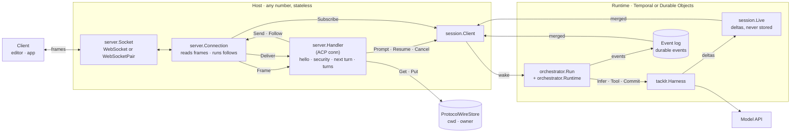
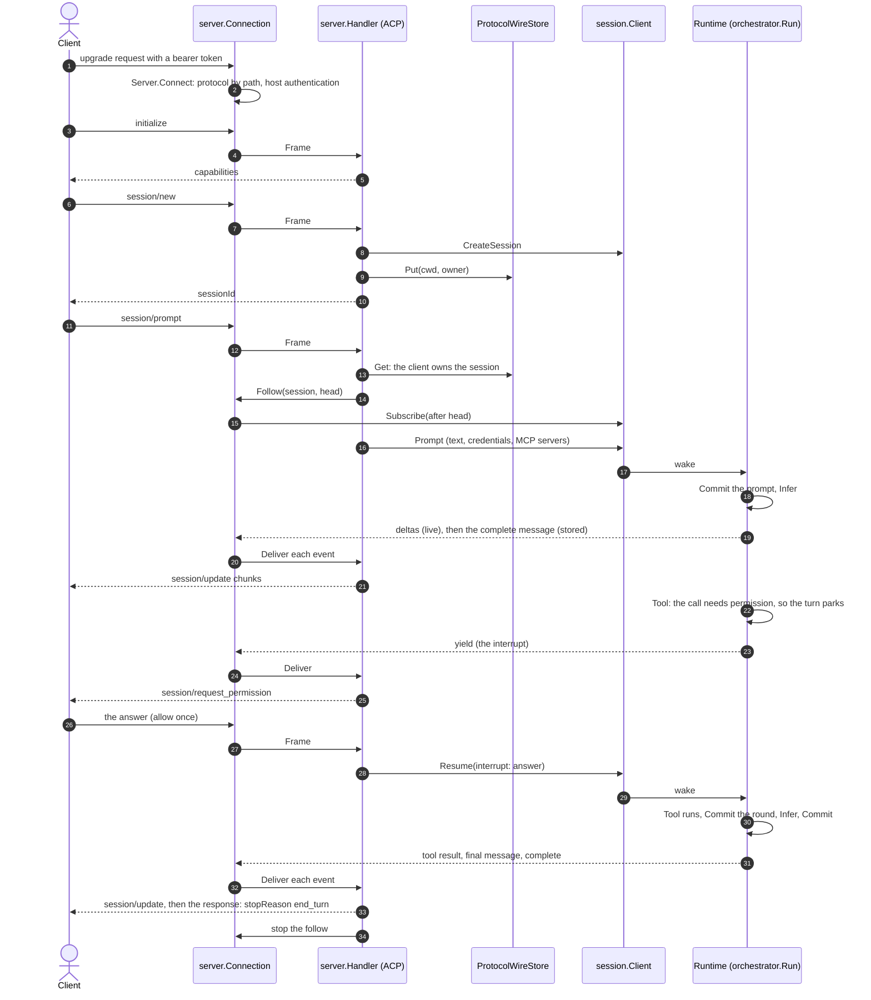

# Protocols: a turn from the client to the answer

A client (an editor, an app) talks to Tacklr through a protocol server: package `server`, with ACP built in (`server/acp`). This guide follows one turn from the user's prompt to the model's final answer, names the abstraction that owns each part, and shows what changes from one host or runtime to another. Nothing in the turn's path changes: the same protocol code runs on net/http and in a Cloudflare connection object, over Temporal or Durable Objects.

For the session itself (rounds, steps, events, the runtimes), see [session.md](session.md).

## Key abstractions

| Abstraction | Package | What it owns or does |
|-------------|---------|----------------------|
| `server.Server` | `server` | The protocols, the session client, and the host's security. `Connect` admits a request as a connection; `ServeHTTP`, `Serve` and `HTTPMux` serve connections as WebSockets on net/http. |
| `server.Socket` | `server` | One connection of text frames, both ways. net/http supplies a WebSocket; Cloudflare supplies the server side of a `WebSocketPair`. |
| `server.Connection` | `server` | One admitted connection: its protocol and the security context of the request that opened it (`Env.Caller`). `Serve` runs it on a socket. |
| `server.Protocol` | `server` | A wire protocol: the `Path` its connections open at, and `Open`, which gives each connection a `Handler`. ACP is `acp.New`. |
| `server.Handler` | `server` (ACP: `server/acp`) | One connection's protocol side. It owns what the connection knows. `Frame` handles each frame from the client, and `Deliver` handles each event of a session it follows. |
| `server.Peer` | `server` | The connection as the handler sees it. `Send` writes a frame, and `Follow` starts the events of a session from a cursor and returns the function that stops them. |
| `server.ProtocolWireStore` | `server`, `server/postgres`, `session/durableobject` | What a protocol adds to a session (for ACP: its cwd and owner), so any host serves any session. |
| `session.Client` | `session` (Temporal: `session/temporal`; Durable Objects: `session/durableobject`) | The session, from outside it: create, prompt, resume, cancel, close, status, subscribe. |
| `session.Subscription`, `session.Event` | `session` | A session's events: the durable ones from its log, and the live deltas between them (`session.Merge`). A failure's `Error` crosses every log and wire with its kind, so a protocol maps it to its stop reason on every runtime. |
| `orchestrator.Run`, `orchestrator.Runtime` | `session/orchestrator` | Inside the session: `orchestrator.Run` decides each step, and the runtime runs it once (`Infer`, `Tool`, `Commit`). |
| `tacklr.Harness` | `tacklr` | One step's work: the model request, the tool call, the commit of the context window. |

## How the parts fit



The handler decides; the connection carries. The handler never waits: it sends its own requests (such as a permission prompt) and handles the answers as frames, and it gets the session's events one call at a time. So the host can hold the socket in a process, or a platform can hold it and call the host for each frame, and the handler does not change.

## A turn, step by step



1. **Connect.** The client opens a WebSocket at the protocol's path. `Server.Connect` finds the protocol and runs the host's HTTP authentication. A credential the host refuses gets 401. A request with no credential opens an anonymous connection, which ACP `authenticate` can raise. The host accepts the socket and calls `Connection.Serve`, which calls `Protocol.Open` for the connection's `Handler`.
2. **Say hello.** `initialize` records the client's capabilities, such as form elicitation. A turn before `initialize` is refused.
3. **Make a session.** `session/new` checks that the principal may create one, calls `Client.CreateSession`, and puts the session's cwd and owner in the wire store.
4. **Prompt.** `session/prompt` reads the wire state: the session must be the principal's. The handler refuses content the model cannot read. Then it follows the session from its head: `Peer.Follow` subscribes before it returns, so no event of the turn is missed. Then it calls `Client.Prompt` with the prompt, the credentials the client bound, and any MCP servers. The prompt request stays open until the turn ends.
5. **The runtime runs the turn.** The prompt wakes the session. `orchestrator.Run` commits the prompt into the window, then runs each step once: `Infer` asks the model, `Tool` runs each call, and `Commit` saves each complete round. On Temporal each step is an activity on a worker; on Durable Objects it runs in the session's object and its result is in the object's journal.
6. **Events come back.** Each stored event (a complete message, a tool call, a tool result, a plan update, the turn's end) goes to the session's event log. Each delta goes live from where the model call runs, and is never stored. `Subscribe` merges both. The connection's follow sets `Event.Streamed` on each complete message, so the handler sends only the text that its deltas did not. The handler turns each event into `session/update` frames.
7. **Park and answer.** A call that needs the user parks the turn: the runtime publishes the interrupt (`yield`), and `Status` is `running` with `Waiting` true. The handler sends `session/request_permission` (or `elicitation/create` for a choice, when the client supports forms), keeps the request in the turn, and returns. The client's answer is a frame: the handler turns it into `Client.Resume`, and the turn goes on. A park the client has no form for ends the prompt with an error, and the turn stays parked for `session/resume` with the answer.
8. **The end.** The runtime commits the session's status, then publishes `complete` (or the error that ended the turn). The handler sends the response to each prompt request of the turn, with `stopReason` `end_turn`, `refusal`, `max_tokens` or `cancelled` (or a JSON-RPC error), and stops the follow.

A second `session/prompt` while the turn runs joins it: the session queues the prompt, and the turn's end answers both requests.

## Cancel

The client cancels a turn in one of these ways. Each one calls `Client.Cancel`, and the prompt ends with `stopReason` `cancelled`:

- `session/cancel`, as a request or a notification.
- An answer that cancels what the turn asked: a permission with outcome `cancelled`, or an elicitation with action `cancel`.

After `session/cancel`, ACP asks the client to answer each open permission with `cancelled`. If the turn already ended, the answer has nothing to resume, and the handler drops it (a JSON-RPC response gets no answer).

A decline, or an answer the agent cannot use, does not cancel: it ends the prompt with an error, and the turn stays parked.

## A client that leaves and comes back

A turn belongs to its session, not to the connection that started it. When a client disconnects, the connection's follows stop, and the turn goes on. A parked turn stays parked. A deploy that closes the sockets is the same.

A client that connects again and sends `session/load` follows the session's turn from then on. When the turn is parked, the handler follows it from one event before the head: the parked turn's last event is its interrupt, so the client is asked again, and its answer finishes the turn. The turn's end answers no request on the new connection: the client sees the rest of the turn as `session/update` frames.

## One owner for each piece of data

| Data | Owner |
|------|-------|
| The session: its window, MCP servers, credentials, turns and events | The runtime, through `session.Client` |
| What ACP adds to a session: its cwd and its owner | The `ProtocolWireStore`, read on each request: `server/postgres` (`postgres.NewWireStore(pool, "acp")`, then `Setup` once per database) or, on Durable Objects, the session's own object (`durableobject.Client.WireStore`) |
| A connection's hello, security context, and the id of the last request it sent the client | The connection's `Handler` |
| What a client gave for a session's next turn: the VFS credentials it bound, and the MCP servers it named on `session/load` | The `Handler`, by session. The next prompt gives them to the session. |
| Each followed turn: the requests its end answers, the questions it asked the client, and how to stop its follow | The `Handler`'s turn. The host keeps only the subscription, which the stop ends. |

## Hosts and runtimes

| Host | Who holds the socket | How it serves a connection |
|------|----------------------|----------------------------|
| net/http (`ServeHTTP`, `Serve`, `HTTPMux`) | The host's process | Accepts a WebSocket, then `Connection.Serve` |
| Cloudflare (`session/durableobject/cloudflare`) | A connection object for each socket | The Worker sends each upgrade to a new connection object, which runs `Server.Connect` on the request, accepts the socket (the standard WebSocket API, so the object stays in memory while the socket is open), and calls `Connection.Serve` |

| Runtime | `session.Client` | Where steps run | Where deltas come from |
|---------|------------------|-----------------|------------------------|
| Temporal | `temporal.Open` | Activities on a worker | The worker's live endpoint, which the client dials |
| Durable Objects | `durableobject.NewClient` | The session's object | The object's memory, on its event stream |

A host where the platform holds the socket and calls the host once for each frame (such as API Gateway with Lambda) needs three more parts: a store for each connection's handler state, a `Peer` whose `Send` posts to the platform, and a trigger that delivers a session's new events. The handler is the same.

## Write a protocol

A host's own protocol implements `server.Protocol`:

```go
type myProtocol struct{}

func (myProtocol) Path() string { return "/mine" }

func (myProtocol) Open(env server.Env, peer server.Peer) server.Handler {
	return &myConn{env: env, peer: peer, turns: map[session.ID]func(){}}
}

// myConn owns what one connection knows; the host calls it one call at a time.
type myConn struct {
	env   server.Env
	peer  server.Peer
	turns map[session.ID]func() // each followed session's stop
}

func (c *myConn) Frame(ctx context.Context, frame []byte) {
	id := session.ID(frame) // parse your own wire here
	stop, err := c.peer.Follow(ctx, id, 0)
	if err != nil {
		_ = c.peer.Send(ctx, []byte(err.Error()))
		return
	}
	c.turns[id] = stop
	_ = c.env.Client.Prompt(ctx, id, session.Prompt{Text: "hello"})
}

func (c *myConn) Deliver(ctx context.Context, id session.ID, ev session.Event) {
	_ = c.peer.Send(ctx, []byte(ev.Content))
	if ev.Type == session.EventComplete || ev.Type == session.EventError {
		c.turns[id]()
		delete(c.turns, id)
	}
}
```

Serve it beside ACP: `server.NewServer(sessions, agent, acp.New(wire), myProtocol{})`.

The rules:

- **Never wait for the client.** Send a request and handle its answer in `Frame`. A call that waits blocks every other frame and event of the connection.
- **Keep the connection's state in the handler**, as plain data, each part in one place. The host keeps nothing for you but each follow's subscription.
- **Follow before you prompt**, so the turn's first events reach you.
- **Stop each follow** when its turn ends. A follow whose stream breaks delivers an `EventError` that wraps `server.ErrStreamEnded`, and ends.

The client, the loop, the harness, the VFS, and the Temporal client and worker compile with no protocol imports.
