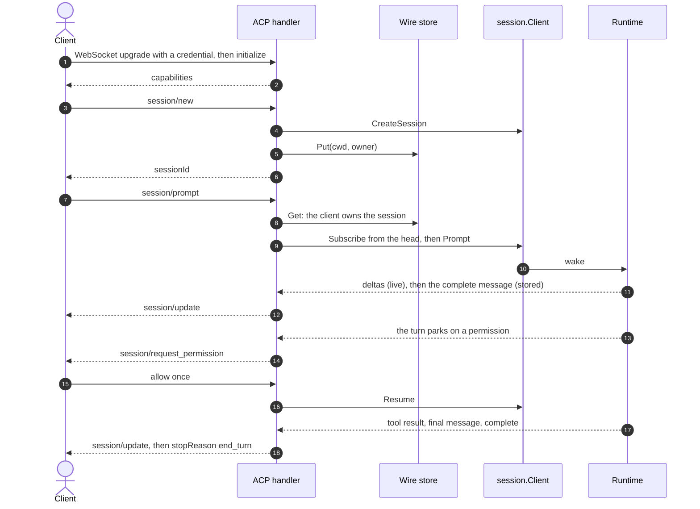

# Protocols

Clients such as editors and apps reach sessions through a protocol server: package `server`, with the [Agent Client Protocol](https://agentclientprotocol.com) (ACP) in `server/acp`. The same protocol code runs on net/http and in a Cloudflare connection object, over Temporal or Durable Objects.

## Serve ACP

```go
wire := postgres.NewWireStore(pool, "acp") // package server/postgres; call Setup once per database
srv := server.NewServer(sessions, tacklr.AgentOptions{Model: model}, acp.New(wire))
srv = srv.WithSecurity(&server.Service{Authenticator: myAuth}, bearerToken)
err := srv.ServeHTTP(ctx, ":8080") // ACP over WebSocket at /acp
```

- `sessions` is a `session.Client`, such as `temporal.Open(...)`.
- The model in `AgentOptions` lets the server refuse content the model cannot read, before it reaches the session.
- The **wire store** keeps what ACP adds to a session (its working directory and its owner), so any host can load any session. Use `server.NewMemoryWireStore()` in tests.
- **Security.** `WithSecurity` takes your `Authenticator`, which turns a credential into a `server.Principal`, an optional `Authorizer`, and a function that reads the credential from the upgrade request. A credential the authenticator refuses gets HTTP 401. A request with no credential opens an anonymous connection, which ACP `authenticate` can raise.
- `HTTPMux` returns the handler, to serve it beside your own routes. `Serve` takes your own listener.

[examples/host](../examples/host) is a complete server behind one bearer token.

## A turn, step by step



1. **Connect.** The client opens a WebSocket at `/acp`. The server runs your authentication on the upgrade request.
2. **Initialize.** The handler records the client's capabilities, such as forms for questions. A prompt before `initialize` is refused.
3. **New session.** `session/new` checks that the principal may create a session, creates it, and stores its working directory and owner.
4. **Prompt.** `session/prompt` checks that the session is the principal's, subscribes to the session's events, and then sends the prompt, so no event of the turn is missed. The request stays open until the turn ends.
5. **Events.** Each event becomes `session/update` frames. When a client got part of a message as deltas, the complete message adds only the rest.
6. **Questions.** A paused turn becomes `session/request_permission`, or `elicitation/create` for a choice when the client supports forms. The answer resumes the turn. When the client has no form for a question, the prompt ends with an error, and the turn stays paused for `session/resume`.
7. **End.** The response to each prompt of the turn carries `stopReason`: `end_turn`, `refusal`, `max_tokens`, or `cancelled`.

A second `session/prompt` while a turn runs joins that turn, and the turn's end answers both requests.

## Cancel

Each of these cancels the turn, and the prompt ends with `stopReason` `cancelled`:

- `session/cancel`, as a request or a notification.
- A permission answer with outcome `cancelled`, or an elicitation answer with action `cancel`.

A rejection, or an answer the agent cannot use, does not cancel: the prompt ends with an error, and the turn stays paused.

## Disconnect and reconnect

A turn belongs to its session, not to the connection. When a client disconnects, the turn goes on, and a paused turn stays paused. A deploy that closes the sockets is the same.

A client that connects again and sends `session/load` follows the session from then on. When the turn is paused, the client is asked its question again, and the answer finishes the turn.

## Tacklr's ACP extensions

| Method | Does |
|---|---|
| `_tacklr/vfs/bind`, `_tacklr/vfs/refresh`, `_tacklr/vfs/unbind` | Bind the user's own folders to the session's workspace, refresh their tokens, and remove them. See [Workspace](workspace.md#users-own-folders). |
| `_tacklr/vfs/token` | Sent to the client: asks for a new token after the source refused the old one. |

`mcpServers` on `session/new` and `session/load` adds MCP servers for the session.

## Write a protocol

A protocol implements `server.Protocol`: the path its connections open at, and `Open`, which returns a `server.Handler` for each connection. The handler gets each frame from the client (`Frame`), each event of the sessions it follows (`Deliver`), and the end of the connection (`Closed`).

```go
type myProtocol struct{}

func (myProtocol) Path() string { return "/mine" }

func (myProtocol) Open(env server.Env, peer server.Peer) server.Handler {
	return &myConn{env: env, peer: peer, turns: map[session.ID]func(){}}
}

// myConn holds what one connection knows. The server calls it one call at a time.
type myConn struct {
	env   server.Env
	peer  server.Peer
	turns map[session.ID]func() // each followed session's stop
}

func (c *myConn) Frame(ctx context.Context, frame []byte) {
	id := session.ID(frame) // parse your own wire format here
	stop, err := c.peer.Follow(ctx, id, 0)
	if err != nil {
		_ = c.peer.Send(ctx, []byte(err.Error()))
		return
	}
	c.turns[id] = stop
	_ = c.env.Client.Prompt(ctx, id, session.Prompt{Text: "hello"})
}

func (c *myConn) Deliver(ctx context.Context, id session.ID, ev session.Event) {
	_ = c.peer.Send(ctx, []byte(ev.Content))
	if ev.Type == session.EventComplete || ev.Type == session.EventError {
		c.turns[id]()
		delete(c.turns, id)
	}
}

// Closed ends what the connection has open. The sessions' turns go on.
func (c *myConn) Closed(context.Context) {}
```

Serve it beside ACP: `server.NewServer(sessions, agent, acp.New(wire), myProtocol{})`.

- **Never wait for the client in a handler.** Send a request, and handle the answer when it arrives in `Frame`. A call that waits blocks the connection's other frames and events.
- **Keep the connection's state in the handler.** The server keeps only each follow's subscription.
- **Follow before you prompt,** so the turn's first events reach you.
- **Stop each follow when its turn ends.** A follow whose stream breaks delivers an `EventError` that wraps `server.ErrStreamEnded`.

A platform that holds the socket and calls the host once for each frame (such as API Gateway with Lambda) needs three more parts: a store for each connection's handler state, a `Peer` whose `Send` posts to the platform, and a trigger that delivers a session's new events. The handler does not change.
