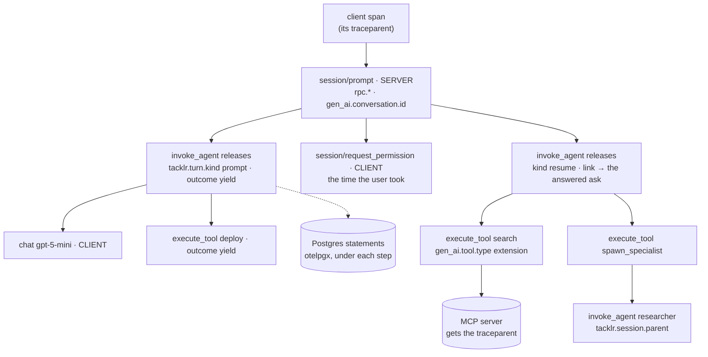

# Telemetry

A turn is one trace. It starts at the client's request and ends with the answer, and it goes through every system the turn touches: the protocol server, the session's runtime (Temporal or Durable Objects), each worker or object that runs a step, the model provider, the MCP servers, Postgres, and each specialist's own session. Tacklr follows the OpenTelemetry conventions: GenAI for the agent, model and tool spans, RPC for the protocol, and the database conventions for Postgres (otelpgx).

Span attributes are static and searchable: identifiers, closed enums, and the outcome and `error.type` that a span sets when it ends. What changes within an operation (lengths, counts, error text, the user's answers) goes on span-correlated logs. Metric labels are closed enums and configuration names, never a session id.

## The trace of a turn



| Span | Kind | Where | Static attributes | At its end |
|------|------|-------|-------------------|------------|
| `{method}`, such as `session/prompt` | SERVER | Protocol server | `rpc.system` jsonrpc, `rpc.method`, `gen_ai.conversation.id` | `rpc.jsonrpc.error_code`, `error.type`, `tacklr.stop_reason` |
| `session/request_permission`, `elicitation/create` | CLIENT | Protocol server | the same, `tacklr.interrupt.kind` | the answer's error code |
| `invoke_agent {agent}` | INTERNAL | Runtime (the workflow, or the session's object) | `gen_ai.operation.name` invoke_agent, `gen_ai.agent.name`, `gen_ai.conversation.id`, `tacklr.turn.kind`, `tacklr.runtime`, `tacklr.session.parent` | `tacklr.outcome` (ok, yield, cancelled, error), `error.type` |
| `chat {model}` | CLIENT | Step | `gen_ai.operation.name` chat, `gen_ai.provider.name`, `gen_ai.request.model`, `tacklr.model.phase` | `gen_ai.usage.*`, `error.type`, `http.response.status_code`, `tacklr.error.code` |
| `execute_tool {tool}` | INTERNAL | Step | `gen_ai.tool.name`, `gen_ai.tool.call.id`, `gen_ai.tool.type`, `tacklr.tool.namespace` | `tacklr.outcome`, `error.type` |
| `tacklr.context.handoff` | INTERNAL | Step | the session and agent | `tacklr.outcome` (ok, fallback, error) |

The protocol request's span is the turn's root in the host: it lasts until the turn's end answers it, so its duration is what the user waited. A turn that parks ends its `invoke_agent` span with outcome `yield`. The resume is a second `invoke_agent` span in the same trace, with a link to the span of the question the user answered. A client that leaves ends the spans it had open with stop reason `disconnected`; the turn goes on, and a client that loads the session again is asked again.

There are no other spans. A step has no span of its own: its model requests and tool calls are its spans. Temporal's plugin and its own spans are not needed (below).

## How the trace crosses each system

| Hop | What carries the trace |
|-----|------------------------|
| Client → protocol server | The request's `_meta.traceparent` (and `tracestate`, `baggage`), else the WebSocket upgrade's `traceparent` header for the whole connection |
| Protocol server → session | `session.Wake.Trace`: each `session.Client` writes the context of the call into the wake it sends (a Temporal signal, a Durable Object mailbox entry) |
| Turn → its steps | The orchestrator keeps the turn's trace in `orchestrator.State` (and its `Carry`, across a park, a crash, a continue-as-new or an eviction). `Runtime.Begin` starts the turn's span once and records its context: on Temporal in a `workflow.SideEffect`, on Durable Objects as a journal entry, so a replay reuses it and starts no span. Each step's input carries it (a Temporal activity's input; on Durable Objects, the step's context) |
| Turn → specialist or job | The child's start carries the turn's context (`protocol.Input.Trace`, `durableobject.Init.Trace`), and the child's first prompt starts its turn in it |
| Step → model provider, MCP server | `telemetry.Transport` writes the `traceparent` header on each request (the OpenAI client and MCP over HTTP use it), so a gateway or an MCP server continues the trace. It starts no span: `chat` and `execute_tool` are the client spans |
| Step → Postgres | otelpgx: a span for each statement under the step's context, on a pool configured with `session/postgres.Configure` or `brain/postgres.Configure` |

Sampling is parent-based in every process (`export.Init`), so each process follows the decision of the trace it joins: a trace is whole or absent.

## Set it up

Each program (a host, a worker) installs the providers once, before it dials Temporal or opens its pool:

```go
shutdown, err := export.Init(ctx, export.Config{ServiceName: "tacklr-worker"}) // OTEL_EXPORTER_OTLP_ENDPOINT, _PROTOCOL
defer shutdown(context.Background())

// Tacklr's logs, with the trace and span of their context.
slog.SetDefault(slog.New(slog.NewMultiHandler(slog.NewTextHandler(os.Stderr, nil), export.SlogHandler())))

cfg, _ := pgxpool.ParseConfig(dsn)
sessionpg.Configure(cfg) // a span for each statement
pool, _ := pgxpool.NewWithConfig(ctx, cfg)

c, _ := temporal.Dial(client.Options{HostPort: addr, Logger: temporallog.NewStructuredLogger(slog.Default())})
```

- `export.Init` installs the SDK's tracer, meter and logger providers, the W3C propagator (trace context and baggage), and the OTLP exporters when an endpoint is set (gRPC by default, or HTTP). With no endpoint the tracer still makes spans, so the trace's context reaches the next process, and nothing is exported. The default target is one OTLP endpoint (Grafana Alloy or the OpenTelemetry Collector, then Tempo, Loki, Mimir and Grafana). `export.PrometheusMeterProvider` serves metrics for a scrape instead.
- `temporal.Dial` reports the Temporal SDK's own metrics (workflow task and activity latencies, polls, failures) to the process-wide meter, unless `client.Options.MetricsHandler` is set. Temporal's tracing plugin and its replay-safe tracer provider are not needed: a turn's span starts once, in a side effect, so the standard SDK provider is replay-safe.
- `examples/temporal` sets up both of its programs this way.

## Logs

Logs carry what changes within an operation, correlated to its span:

| Log event | Of | Attributes |
|-----------|----|------------|
| `turn.started` | `invoke_agent` | the prompt's length, the answers it resumed with |
| `turn.ended` (error) | `invoke_agent` | the error's text |
| `gen_ai.request` | `chat` | its sequence in the session, the window's messages and tool pairs, whether it follows tool calls |
| `provider.failed` (error) | `chat` | the input items, `error.type`, the HTTP status and error code |
| `tool.failed` (warn) | `execute_tool` | the error's text |
| `tacklr.context.handoff` | the handoff | the open todos |
| `plan.installed` | the step | the todos and the open todos, or the error |
| `vfs.fuse.mount`, `vfs.fuse.unmount` | the step | the session |

Tacklr's own diagnostics are `slog` records with their context (`slog.WarnContext`, ...), with an `area` field (runtime, harness, model_tasks, context). With `export.SlogHandler` they reach the same logs, with the trace and span ids. On Temporal the workflow's logger is the client's `Logger`.

## Metrics

| Metric | Type | Labels |
|--------|------|--------|
| `tacklr.turn.duration`, `tacklr.turn.total` | histogram (s), counter | `gen_ai.agent.name`, `tacklr.turn.kind`, `outcome` |
| `tacklr.turn.active` | up-down counter | `gen_ai.agent.name`, `tacklr.turn.kind` |
| `gen_ai.client.operation.duration` | histogram (s) | `gen_ai.operation.name`, `gen_ai.provider.name`, `gen_ai.request.model`, `gen_ai.agent.name`, `tacklr.model.phase`, `error.type` |
| `gen_ai.client.token.usage` | histogram ({token}) | the same, `gen_ai.token.type` (input, output, reasoning) |
| `tacklr.tool.calls`, `tacklr.tool.duration` | counter, histogram (s) | `gen_ai.agent.name`, `gen_ai.tool.name`, `tacklr.tool.namespace`, `status` |
| `tacklr.interrupt.total` | counter | `gen_ai.agent.name`, `kind` |
| `tacklr.context.handoff.total`, `tacklr.context.compress.total` | counter | `gen_ai.agent.name`, `outcome` |
| `rpc.server.call.duration` | histogram (s) | `rpc.system`, `rpc.method`, `error.type` |
| `tacklr.server.connections` | up-down counter | `protocol` |
| `tacklr.session.created.total`, `tacklr.checkpoint.save.total`, `tacklr.fuse.mount.total` | counter | `outcome` |
| Temporal SDK metrics (`temporal_*`) | | Temporal's |

A runtime counts a turn once: the turn's metrics are recorded with its span, which a replay does not start again.

## Cloudflare Workers

A Worker's turn is one trace in the same way: the connection object reads the upgrade's or the request's `traceparent`, each wake and each child's `Init` carry the context between objects, and model and MCP requests send it. When the Worker's env names `OTEL_EXPORTER_OTLP_ENDPOINT` (and, for an API key, `OTEL_EXPORTER_OTLP_HEADERS`; `OTEL_SERVICE_NAME` names the Worker), the bridge installs a tracer that sends spans in batches to that endpoint as OTLP/HTTP in its JSON encoding (`telemetry/otlpjson`), over `fetch`. The OTLP exporters' protobuf and gRPC code would take the program past its size budget; this one adds under 1 MiB. The bridge sends what it holds when an object runs nothing, after each alarm, and when a connection ends, since the platform can stop an idle object.

On Workers only traces are exported: metrics and logs stay on Workers' own observability.

## For contributors

The `telemetry` package depends only on the OpenTelemetry API, so it builds anywhere the harness does, wasm included. `telemetry/export` installs the SDK and exporters for a host process. Start Tacklr's spans only through the package's starters (`StartTurn`, `StartModelSpan`, `StartToolSpan`, `StartRPC`, `StartHandoffSpan`), and carry a trace across a boundary with `telemetry.Inject` and `Carrier.Context`. `server/acp`'s `TestACP_aTurnIsOneTraceThroughEverySystemItTouches` checks the whole trace on both runtimes.
